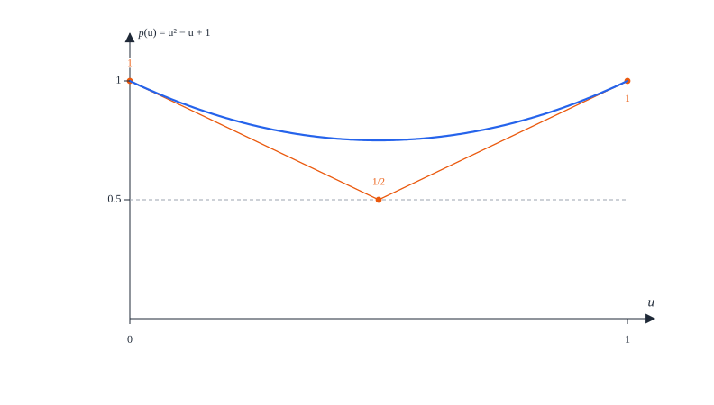

# Appendix L. Eight squares: what a table row proves

[Contents](README.md) · [← Appendix K](appendix-k.md) · [Appendix M →](appendix-m.md)

This appendix proves part (1) of
[Proposition 11.31](11-eight.md#proposition-1131-rows-and-tables): a row of
an affine-arc table, with its fixed rational data, proves the inequality
(11.10) on a whole product of two arcs of states and an interval of angles,
by finitely many rational comparisons. It also describes how the covers of
the tables are checked (§L.6) and the pair tables by which the formal proof
proves the smaller tables of
[Proposition 11.21](11-eight.md#proposition-1121-pair-costs-of-the-four-types-a-finite-table)
and [Proposition 11.26](11-eight.md#proposition-1126-only-the-word-0101011-finite-tables)
(§L.7).

Fix a row: an edge with charge $\beta \ge 0$ and constant $\gamma$, a source
arc with sign $\sigma$ and label $L_s = c + p\,a + q\,b$, a target arc with
sign $\sigma'$ and label $L_t = c' + p'a' + q'b'$, a margin $M_j$ of (11.5), a
multiplier $\lambda \ge 0$ and an angle interval
$\varphi = k\frac\pi2 + \epsilon u$, $u_0 \le u \le u_1$, with $k \in \lbrace 0, 1\rbrace$,
$\epsilon = \pm1$ and $0 \le u_0 \le u_1 \le \frac7{10}$. We must show that

```math
G = \varphi - \beta\chi(\varphi) + L_s(a, b) - L_t(a', b') - \gamma - \lambda M_j > 0 \tag{L.1}
```

for all states $(a, b)$ on the source arc, $(a', b')$ on the target arc, and
$u \in [u_0, u_1]$.

## L.1 Arcs of the radial curves

On the outer curve $\mathcal O_Q$ and on the corner of the core curve
$\mathcal C$ the first coordinate is a function of the second,

```math
a(b) = v + \sqrt{\rho^2 - (b - v)^2}, \qquad \text{with } (v, \rho) = \left(-\tfrac12, \sqrt Q\right) \text{ on } \mathcal O_Q \text{ and } \left(\tfrac12, \tfrac1{12}\right) \text{ on the corner of } \mathcal C ,
```

and on the side of $\mathcal C$ it is the constant $\frac7{12}$. An arc is
given by two rational values of the tangent $b/a$; its endpoints are the
positive roots of quadratic equations with rational coefficients, enclosed by
rational brackets whose squares are compared with the radicands. On a circular
piece, with $\varrho(b) = \frac{b - v}{a(b) - v}$,

```math
a'(b) = -\varrho(b), \qquad \varrho'(b) = \frac{\rho^2}{(a - v)^3} > 0, \qquad a''(b) = -\varrho'(b) < 0 .
```

*Lean:
[`Eight.Arithmetic.ArcData`](../../SquaresInCircles/Eight/Arithmetic/AffineTableData.lean#L35),
[`Eight.Arithmetic.ArcData.OnCurve`](../../SquaresInCircles/Eight/Arithmetic/AffineTableData.lean#L50),
[`Eight.Arithmetic.outerEndpoint_facts`](../../SquaresInCircles/Eight/Arithmetic/ArcGeometry.lean#L41),
[`Eight.Arithmetic.coreEndpoint_facts`](../../SquaresInCircles/Eight/Arithmetic/ArcGeometry.lean#L69),
[`Eight.Arithmetic.circleX_deriv`](../../SquaresInCircles/Eight/Arithmetic/AffineArc.lean#L174),
[`Eight.Arithmetic.circleRatio_deriv`](../../SquaresInCircles/Eight/Arithmetic/AffineArc.lean#L185),
[`Eight.Arithmetic.PreparedArc`](../../SquaresInCircles/Eight/Arithmetic/PreparedArc.lean#L56),
[`Eight.Arithmetic.PreparedArc.NumericValid`](../../SquaresInCircles/Eight/Arithmetic/PreparedArc.lean#L100).*

### Lemma L.1 (supports on an arc)

Let $X$ and $Y$ be real numbers, and consider the linear function
$X a + Y b$ of the states on one arc. Its minimum over the arc is at least:

1. on a side of $\mathcal C$, the smaller of its two endpoint values;
2. on a circular piece, if $X \ge 0$, the smaller of its two endpoint values;
3. on a circular piece, if $Y - X\varrho \ge 0$ at both endpoints, its value
   at the lower endpoint, and if $Y - X\varrho \le 0$ at both endpoints, its
   value at the upper endpoint;
4. on a circular piece of the circle with centre $(v, v)$ and radius $\rho$,
   the number $v(X + Y) - \rho\sqrt{X^2 + Y^2}$.

*Proof.* (1) The function is affine in $b$ on a segment. (2) $X a(b) + Y b$ is
concave in $b$ when $X \ge 0$, so its minimum on an interval is at an end.
(3) Its derivative in $b$ is $Y - X\varrho(b)$, which is affine in $\varrho$,
and $\varrho$ is monotone in $b$; so the derivative lies between its endpoint
values and has the sign of both. (4) The arc lies on the circle, and on the
whole circle the minimum of the linear function is the value at the centre
minus $\rho$ times the length of $(X, Y)$, by Cauchy–Schwarz. $\square$

*Lean:
[`Eight.Arithmetic.side_endpoint_lower`](../../SquaresInCircles/Eight/Arithmetic/AffineArc.lean#L159),
[`Eight.Arithmetic.circle_functional_concave`](../../SquaresInCircles/Eight/Arithmetic/AffineArc.lean#L214),
[`Eight.Arithmetic.circle_endpoints_lower`](../../SquaresInCircles/Eight/Arithmetic/AffineArc.lean#L227),
[`Eight.Arithmetic.circle_lower_endpoint`](../../SquaresInCircles/Eight/Arithmetic/AffineArc.lean#L247),
[`Eight.Arithmetic.circle_upper_endpoint`](../../SquaresInCircles/Eight/Arithmetic/AffineArc.lean#L265),
[`Eight.Arithmetic.full_circle_lower`](../../SquaresInCircles/Eight/Arithmetic/AffineArc.lean#L144).*

The rules hold whatever the sign of $X$ in rule 3, and rule 4 holds even when
the point of the circle where the minimum is attained lies outside the arc;
it is never used on a side. A row records which rule it uses for the target
arc; for the source arc the rule is determined by the signs of the fixed
coefficients.

![Two panels of the (a, b)-plane near the outer curve of the level Q1, each with an arc of the curve drawn thick between two endpoints and level lines of a linear function X a + Y b, the lowest one dashed. Left: X = 0.8 and Y = -1, for the arc of tangents from 1/8 to 3/8; the function is concave along the arc and its least value is at the upper endpoint, marked. Right: X = -1 and Y = -0.6, for the arc of tangents from 1/4 to 1/2; the dashed level line of the circle bound v(X + Y) - rho root(X^2 + Y^2) touches the full circle at a point of the arc, marked, so the bound is attained there](figures/appendix-l/supports.svg)

*Figure L.1.* Lemma L.1 on two arcs of $\mathcal O_{Q_1}$ (thick). Left: with
$X \ge 0$ the function is concave along the arc, and its least value is at an
endpoint (dot). Right: the circle rule takes the least value on the whole
circle, at the point where a level line (dashed) touches it; it is a lower
bound on every arc, and here, where that point lies on the arc, it is
attained.

## L.2 The separating-axis reduction

### Lemma L.2 (separating the source and the target)

For the axes 1 and 4,

```math
G = \varphi - \beta\chi(\varphi) + c - c' - \gamma + \lambda\tau(\varphi) + X_s a + Y_s b + X_t a' + Y_t b' ,
```

with the coefficients

| axis | $X_s$ | $Y_s$ | $X_t$ | $Y_t$ |
| :-: | :-: | :-: | :-: | :-: |
| 1 | $p$ | $q - \lambda\sigma$ | $-p' - \lambda\sin\varphi$ | $-q' + \lambda\sigma'\cos\varphi$ |
| 4 | $p - \lambda$ | $q$ | $-p' + \lambda\cos\varphi$ | $-q' + \lambda\sigma'\sin\varphi$ |

and the squared lengths $X_t^2 + Y_t^2$ are
$V_1 = p'^2 + q'^2 + \lambda^2 + 2p'\lambda\sin\varphi - 2q'\lambda\sigma'\cos\varphi$
and
$V_4 = p'^2 + q'^2 + \lambda^2 - 2p'\lambda\cos\varphi - 2q'\lambda\sigma'\sin\varphi$.
The axes 2 and 3 reduce to the axes 4 and 1: reflecting the plane and
reversing the edge exchanges the source and the target, changes both signs,
leaves $\varphi$ unchanged, turns $M_2$ into $M_4$ and $M_3$ into $M_1$, and
the cost stays the same if the labels are replaced by $-L_t$ and $-L_s$.

*Proof.* Substitute (11.5) and the labels into (L.1) and collect the terms in
$a$, $b$, $a'$, $b'$; the squared lengths follow from
$\sin^2\varphi + \cos^2\varphi = 1$. For the reduction, the reversed pair has
the source state $(a', b')$ with sign $-\sigma'$ and the target state $(a, b)$
with sign $-\sigma$ at the same angle, and substituting into (11.5) turns the
margins as stated; the cost $\varphi + L_s - L_t$ equals
$\varphi + (-L_t) - (-L_s)$. $\square$

*Lean:
[`Eight.Arithmetic.forwardMargin`](../../SquaresInCircles/Eight/Arithmetic/AffineArc.lean#L72),
[`Eight.Arithmetic.forwardMargin_actual`](../../SquaresInCircles/Eight/Arithmetic/AffineArc.lean#L80),
[`Eight.Arithmetic.margin_reverse`](../../SquaresInCircles/Eight/Arithmetic/AffineArc.lean#L92),
[`Eight.Arithmetic.charge_reverse`](../../SquaresInCircles/Eight/Arithmetic/AffineArc.lean#L98),
[`Eight.Arithmetic.lagrangian_identity`](../../SquaresInCircles/Eight/Arithmetic/AffineArc.lean#L132).*

So, for a fixed angle, $G$ is a constant plus a linear function on the source
arc with constant coefficients, plus a linear function on the target arc whose
coefficients depend on $\varphi$. Lemma L.1 bounds the first by a rational
number, and the second by an endpoint value, which is a trigonometric
polynomial in $\varphi$ with algebraic coefficients, or by the circle bound,
which contains the radical $\sqrt{V_j}$.

## L.3 The last radical

### Lemma L.3 (a polynomial majorant of the square root)

For a rational $h_0 > 0$ and every $V \ge 0$, with

```math
T_{h_0}(V) = \frac1{16}\left(5h_0 + \frac{15V}{h_0} - \frac{5V^2}{h_0^3} + \frac{V^3}{h_0^5}\right),
```

we have $T_{h_0}(V) \ge \sqrt V$; indeed

```math
T_{h_0}(V) - \sqrt V = \frac{\left(\sqrt V - h_0\right)^4\left(V + 4h_0\sqrt V + 5h_0^2\right)}{16h_0^5} .
```

*Proof.* With $w = \sqrt V$, both sides multiplied by $16h_0^5$ equal
$w^6 - 5h_0^2 w^4 + 15h_0^4 w^2 - 16h_0^5 w + 5h_0^6$, as one checks by
expanding $(w - h_0)^4(w^2 + 4h_0 w + 5h_0^2)$. $\square$

So the circle bound $v(X_t + Y_t) - \rho\sqrt{V_j}$ is at least
$v(X_t + Y_t) - \rho\,T_{h_0}(V_j)$, a polynomial in $\sin\varphi$ and
$\cos\varphi$. The majorant touches $\sqrt V$ to fourth order at $V = h_0^2$,
and a row chooses $h_0$ near the value of $\sqrt{V_j}$ on its interval
(Figure L.2). No minimization over states remains.


*Figure L.2.* Lemma L.3 for $h_0 = 1$: the majorant $T_{h_0}(V)$ (dashed)
lies above $\sqrt V$ (solid) and touches it at $V = h_0^2$, where the
difference (right, enlarged) vanishes to fourth order.

## L.4 One angle

The angle enters through $\sin\varphi$, $\cos\varphi$ and
$\chi(\varphi)$. With $\varphi = k\frac\pi2 + \epsilon u$ and
$0 \le u \le \frac7{10}$,

```math
\tau(\varphi) = \tfrac12(1 + \sin u + \cos u), \qquad \chi(\varphi) = \tfrac12(\sin u + \cos u - 1), \qquad (\sin\varphi, \cos\varphi) = \begin{cases} (\epsilon\sin u,\ \cos u), & k = 0, \\ (\cos u,\ -\epsilon\sin u), & k = 1 . \end{cases}
```

### Lemma L.4 (Taylor bounds with interval remainders)

For $u \ge 0$,

```math
\sin u = S_7(u) + e_s u^9, \qquad \cos u = C_8(u) + e_c u^{10}, \qquad 0 \le e_s \le \tfrac1{9!}, \qquad -\tfrac1{10!} \le e_c \le 0 ,
```

where $S_7$ and $C_8$ are the Taylor polynomials of degrees 7 and 8 and
$e_s$, $e_c$ depend on $u$. Moreover
$3.14159265 < \pi < 3.14159266$, by Machin's formula and the alternating
series of the arctangent; so $2\pi < \frac{710}{113}$ and
$2\pi < 6.28318531$.

*Proof.* The alternating series give $S_7(u) \le \sin u \le S_9(u)$ and
$C_{10}(u) \le \cos u \le C_8(u)$ for $u \ge 0$, and
$S_9 - S_7 = \frac{u^9}{9!}$, $C_{10} - C_8 = -\frac{u^{10}}{10!}$. $\square$

*Lean:
[`Eight.Arithmetic.trig_taylor_bounds`](../../SquaresInCircles/Eight/Arithmetic/Taylor.lean#L78),
[`Eight.Arithmetic.sin_remainder_coefficient`](../../SquaresInCircles/Eight/Arithmetic/Taylor.lean#L84),
[`Eight.Arithmetic.cos_remainder_coefficient`](../../SquaresInCircles/Eight/Arithmetic/Taylor.lean#L99),
[`Eight.Arithmetic.pi_hand_enclosure`](../../SquaresInCircles/Eight/Arithmetic/Taylor.lean#L28),
[`Eight.Arithmetic.two_pi_lt_710_over_113`](../../SquaresInCircles/Eight/Arithmetic/Taylor.lean#L33),
[`Eight.Arithmetic.two_pi_lt_628318531_over_1e8`](../../SquaresInCircles/Eight/Arithmetic/Taylor.lean#L36).*

Substituting these expressions, with the interval coefficients $e_s$ and
$e_c$ and the rational brackets of $\pi$ and of the algebraic endpoint
coordinates, turns each bound of §L.2 and §L.3 into a polynomial in $u$
whose coefficients are intervals. Since $u \ge 0$, replacing every coefficient
by the lower end of its interval gives a polynomial $\underline G(u)$ with
rational coefficients and $\underline G(u) \le$ the bound, pointwise, even
though $e_s$ and $e_c$ vary with $u$; no derivative of a remainder is needed.
Its degree is at most 10 for the endpoint rules and at most 30 for the circle
rule. The support premises of the rules (the sign conditions in Lemma L.1 (2)
and (3)) are treated in the same way, as polynomial inequalities in $u$.

### Lemma L.5 (Bernstein coefficients)

Let $\underline G$ be a polynomial of degree $n$ and $[u_0, u_1]$ an interval.
Write $\underline G(u_0 + (u_1 - u_0)x) = \sum_{j=0}^n g_j\binom nj x^j(1 - x)^{n - j}$.
If every $g_j > 0$, then $\underline G > 0$ on $[u_0, u_1]$; if every
$g_j \ge 0$, then $\underline G \ge 0$ there.

*Proof.* The Bernstein basis polynomials are nonnegative on $[0, 1]$ and add
up to $(x + 1 - x)^n = 1$, so $\underline G$ is at least the least $g_j$. $\square$

*Lean:
[`Eight.Arithmetic.bernsteinBasis_nonneg`](../../SquaresInCircles/Eight/Arithmetic/Bernstein.lean#L42),
[`Eight.Arithmetic.bernsteinBasis_sum`](../../SquaresInCircles/Eight/Arithmetic/Bernstein.lean#L49),
[`Eight.Arithmetic.bernstein_lower`](../../SquaresInCircles/Eight/Arithmetic/Bernstein.lean#L63),
[`Eight.Arithmetic.BernsteinRow.Valid.sound`](../../SquaresInCircles/Eight/Arithmetic/Bernstein.lean#L99),
[`Eight.Arithmetic.BernsteinRow.valid_of_check`](../../SquaresInCircles/Eight/Arithmetic/BernsteinCheck.lean#L121).*

## L.5 Proof of Proposition 11.31 (1)

*Proof.* Reduce the axes 2 and 3 to 4 and 1 by Lemma L.2. For each $u$ in the
row's interval, $G$ is at least the rational lower bound of the source term
(Lemma L.1, by the signs of the constant coefficients $X_s$, $Y_s$) plus the
bound of the target term by the row's rule (Lemma L.1, with Lemma L.3 for the
circle rule), plus the explicit terms in $\varphi$. Lemma L.4 turns this into
a polynomial $\underline G(u)$ with $\underline G \le G$, and the premises of
the rule into polynomials whose nonnegativity implies them. The row supplies
lower bounds for the Bernstein coefficients of all these polynomials on
$[u_0, u_1]$; if the premise coefficients are nonnegative and the cost
coefficients positive, Lemma L.5 gives (L.1). Every step is an inequality
valid on the whole product of the two arcs and the interval. $\square$

*Lean:
[`Eight.Arithmetic.CoreRow`](../../SquaresInCircles/Eight/Arithmetic/CoreRow.lean#L33),
[`Eight.Arithmetic.CoreRow.Positive`](../../SquaresInCircles/Eight/Arithmetic/CoreRow.lean#L67),
[`Eight.Arithmetic.coreCheck_positive`](../../SquaresInCircles/Eight/Arithmetic/RowCheck.lean#L1116),
[`Eight.Arithmetic.CoreRow.sound_of_positive`](../../SquaresInCircles/Eight/Arithmetic/CoreRow.lean#L79),
[`Eight.Arithmetic.PreparedRow.sound_of_positive`](../../SquaresInCircles/Eight/Arithmetic/PreparedRow.lean#L62),
[`Eight.Arithmetic.PreparedRow.claim_of_positive`](../../SquaresInCircles/Eight/Arithmetic/PreparedRow.lean#L136),
[`Eight.Arithmetic.checkRow_claim`](../../SquaresInCircles/Eight/Arithmetic/RowCheck.lean#L1277).*

In the formal proof the data of a row are only its arcs, axis, angle
interval, multiplier, rule and $h_0$; the polynomial $\underline G$, its
Bernstein coefficients and their positivity are recomputed in Lean, and the
expansion is checked as an identity of polynomials with rational coefficients,
so that no coefficient list is trusted. A row whose arithmetic fails makes
the table's proof fail; nothing else is assumed about it.



*Figure L.3.* A small example of Lemma L.5: $p(u)=u^2-u+1$ has Bernstein
coefficients $1,1/2,1$ on $[0,1]$, so $p(u)\ge1/2$. The curve lies above
the smallest coefficient. The affine-arc rows use the same argument at higher degree.

## L.6 Covers

A table proves its cyclic bound only if every case is covered. Two kinds of
cover are checked, separately from the rows.

*States.* For each role and sign, the closed tangent intervals of the arcs of
that role, on $\mathcal O_Q$ and on $\mathcal C$, must cover the declared
interval of the signed tangent, consecutive arcs sharing an endpoint, and the
core curve must be cut at the tangent $\frac67$ between its side and its
corner. At a shared endpoint either arc may be chosen, once for the square, so
that each square has one label on both of its edges.

*Angles.* For a pair of arcs with signed tangent angles in
$[\alpha_s^-, \alpha_s^+]$ and $[\alpha_t^-, \alpha_t^+]$, the gap bounds
(11.4) and $\delta = \varphi + \alpha_s - \alpha_t$ give the necessary range

```math
\tfrac{19}{25} - \alpha_s^+ + \alpha_t^- < \varphi < \tfrac{710}{113} - \tfrac{114}{25} - \alpha_s^- + \alpha_t^+ ,
```

which is intersected with $k\frac\pi2 + [-\frac7{10}, \frac7{10}]$, and with
the declared range of the frame difference when an earlier mismatch bound is
assumed. The arctangent endpoints are enclosed by the addition formula: choose the nearest
anchor $c=j/16$ and write $\arctan x=\arctan c+\arctan z$, where
$z=(x-c)/(1+xc)$ and $|z|\le1/32$. The degree-nine and degree-eleven
alternating polynomials bound the small correction. The seventeen anchor bounds
follow successively from the same formula, with correction
$16/(256+j(j+1))$, and all bounds are rounded outwards over $10^{20}$.
For every edge, pair of arcs
and permitted original axis, the rows' angle intervals must form a closed
chain covering both halves, $\epsilon = \pm1$, of the necessary range,
consecutive intervals meeting at a common rational endpoint; an isolated
endpoint of the range must be covered too.

*Lean:
[`Eight.Arithmetic.StateChains`](../../SquaresInCircles/Eight/Arithmetic/StateCoverage.lean#L142),
[`Eight.Arithmetic.StateChains.covers`](../../SquaresInCircles/Eight/Arithmetic/StateCoverage.lean#L159),
[`Eight.Arithmetic.boundary_arc_contains`](../../SquaresInCircles/Eight/Arithmetic/StateCoverage.lean#L127),
[`Eight.Arithmetic.ClosedChain`](../../SquaresInCircles/Eight/Arithmetic/ClosedCover.lean#L31),
[`Eight.Arithmetic.ClosedChain.covers`](../../SquaresInCircles/Eight/Arithmetic/ClosedCover.lean#L40),
[`Eight.Arithmetic.PairCover.atanLo_le`](../../SquaresInCircles/Eight/Arithmetic/AtanBounds.lean#L303),
[`Eight.Arithmetic.PairCover.le_atanHi`](../../SquaresInCircles/Eight/Arithmetic/AtanBounds.lean#L320),
[`Eight.Arithmetic.endpointsValid_atanEnds`](../../SquaresInCircles/Eight/Arithmetic/RowCover.lean#L618),
[`Eight.Arithmetic.AffineCover.required_mem`](../../SquaresInCircles/Eight/Arithmetic/AffineCoverage.lean#L223),
[`Eight.Arithmetic.coverBlocks_sound`](../../SquaresInCircles/Eight/Arithmetic/RowCover.lean#L532).*


*Figure L.4.* The state cover of one role in the coarse table of
Proposition 11.34 (1): the arcs of the role $G$, with the sign $-1$, on
$\mathcal O_{Q_1}$ and on $\mathcal C$ (alternately coloured). Their endpoints
are rational tangents, consecutive arcs share an endpoint, and together they
cover both curves over the declared range $\frac1{20} \le b/a \le \frac45$,
that is $-\frac45 \le \tau_G \le -\frac1{20}$; on $\mathcal C$ this range
lies on the side, below the cut at $\frac67$.

## L.7 Pair tables

The four-type table of Proposition 11.21 and the word tables of
Proposition 11.26 are proved by rows of the same kind, on arcs chosen for each
problem, together with a coverage tree for each problem.

*Problems.* A problem fixes a source end and a target end, each with a chart
(the outer curve, or the side or the corner of the core curve), a closed
interval of the tangent $b/a$, a sign and a label; an original axis; a charge
$\beta$ ($\frac9{50}$ for the four types, 0 for the words); a target
$\gamma$; and halves $(k, \epsilon, u^+)$, on which
$\varphi = k\frac\pi2 + \epsilon u$ with $0 \le u \le u^+$. The four-type
problems have the six halves $(0, -, 1)$, $(0, +, \frac45)$,
$(1, \pm, \frac45)$, $(2, -, \frac45)$, $(2, +, \frac{43}{50})$, which cover
$\varphi \in [-1, 4]$ because $\frac\pi2 - \frac45 \le \frac45$ and
$\pi + \frac{43}{50} \ge 4$; the word problems have the two halves
$(k, \pm, \frac7{10})$ of the frame difference. The claim of a problem is
the charged inequality $\gamma < \varphi + L_s(a, b) - L_t(a', b') - \beta
\chi(\varphi)$ for all states on its two ends and all angles of a half that
satisfy the gap bounds (11.4) and the margin of its axis.

*Labels.* A label is $c + pa + qb + rb^2 + sab$ whose constant $c$ lies in a
rational interval: it contains $\sqrt{Q_0 - \frac14}$ or $\sqrt{Q_0/2}$ and
$\pi$ for two of the four types, and $r$, $s$ vanish except for the markers of
$0011011$. An arc of a table carries an affine label, below the label on the
whole arc for a source arc and above it for a target arc. On a circle chart
$a^2 + b^2 = \kappa_0 + \kappa_1(a + b)$, and each of $x = a, b, a + b, a - b$
lies between bounds $x^- \le x \le x^+$ given by the supports of Lemma L.1 on
the arc, so $(x - x^-)(x^+ - x) \ge 0$. The difference of the label and the
affine label, minus nonnegative multiples of these products (fixed by the signs
of $r$ and $s$) and a multiple of the circle identity, is affine in $(a, b)$,
and its minimum over $[a^-, a^+] \times [b^-, b^+]$ must be nonnegative. On
the side $a = \frac7{12}$, and $b^2$ is bounded above by its secant and below
by its tangent at the midpoint.

*Trees.* A tree splits the box (source tangent) $\times$ (target tangent)
$\times$ $u$ of a half by bisections. At a gap leaf, rational bounds of the
arctangents at the ends of the two tangent intervals confine $u$, through
(11.4), to an interval disjoint from the cell; at a trim leaf, to a
subinterval on which the tree goes on. At a row leaf the next row of the table
covers the cell: its arcs contain the two tangent intervals, on the same charts
with the same signs and labels; its angle interval contains the cell's; and it
has the axis, the quarter and the half of the problem and a target at least
$\gamma$. The rows are taken in the order of the leaves. The arctangent bounds
use $\arctan x = \arctan c + \arctan\frac{x - c}{1 + xc}$ at the anchor
$c = \frac j{16}$ nearest to $x$ and the alternating series through the powers
9 and 11; each anchor follows from the previous one by the same formula.

*Lean:
[`Eight.Arithmetic.PairCover.PairProblem.Cell`](../../SquaresInCircles/Eight/Arithmetic/PairCover.lean#L86),
[`Eight.Arithmetic.PairCover.treeCheck_sound`](../../SquaresInCircles/Eight/Arithmetic/PairCover.lean#L492),
[`Eight.Arithmetic.PairCover.problemsCheck_sound`](../../SquaresInCircles/Eight/Arithmetic/PairCover.lean#L618),
[`Eight.Arithmetic.PairCover.table_sound`](../../SquaresInCircles/Eight/Arithmetic/PairCover.lean#L639),
[`Eight.Arithmetic.lowerCheck_sound`](../../SquaresInCircles/Eight/Arithmetic/LabelRelax.lean#L287),
[`Eight.Arithmetic.labelsCheck_sound`](../../SquaresInCircles/Eight/Arithmetic/LabelRelax.lean#L384),
[`Eight.Arithmetic.PairCover.anchor_bounds`](../../SquaresInCircles/Eight/Arithmetic/AtanBounds.lean#L227),
[`Eight.Arithmetic.PairCover.atanLo_le`](../../SquaresInCircles/Eight/Arithmetic/AtanBounds.lean#L303),
[`Eight.Arithmetic.PairCover.le_atanHi`](../../SquaresInCircles/Eight/Arithmetic/AtanBounds.lean#L320).*
