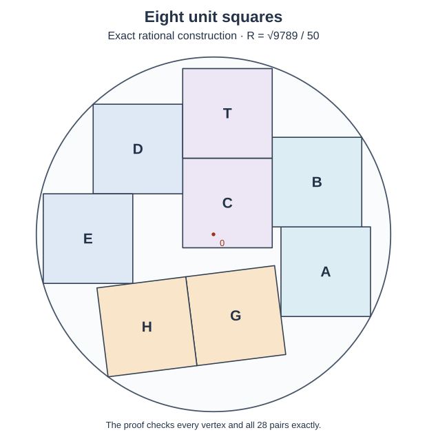

# An explicit rational packing of eight unit squares

**Status.** This note proves, by exact coordinates and elementary separating
lines, the unconditional upper bound

$$
 R_8\le \frac{\sqrt{9789}}{50}=1.9787875\ldots .
$$

Here $R_8$ is the least radius of a disk containing eight unit squares
with pairwise disjoint open interiors. The bound is slightly above the
previously isolated candidate $R_*=1.9787708653\ldots$. It is not a sharp
optimality claim. Its purpose is a short, complete construction proof that
does not depend on a root-isolation program, an interval cover, or a
floating-point diagram.

Every parameter below is rational. The small integer comparisons in the
containment table are the complete arithmetic certificate for these fixed
coordinates; there is no continuous search hidden in the proof.

The diagram illustrates the stated coordinates. The exact containment and
separation arguments follow below.

## 1. Coordinates

Set

$$
\begin{aligned}
q&=\frac{9789}{2500},&
u&=\frac{11}{12},&
r&=\frac{1753659}{1000000},\\
U&=\frac{331179}{200000},&
v&=\frac{547767}{1000000},&
w&=\frac{95073}{50000}.
\end{aligned}
$$

Use the orthonormal frame

$$
c=\frac{255}{257},\qquad s=\frac{32}{257},\qquad
e=(c,s),\qquad f=(-s,c).
$$

It is orthonormal because $255^2+32^2=257^2$. Define

$$
\begin{aligned}
h_1&=cr-su-2-c=-\frac{210690173}{154200000},\\
h_2&=sw-cv-1-s=-\frac{73566773}{51400000}.
\end{aligned}
$$

The five distinguished vertices are

$$
\begin{aligned}
P_1&=(r,-u),&
P_2&=(U,2-u),&
P_3&=(U-3,2-v),\\
P_4&=(-w,-v),&
P_5&=h_1e+h_2f.
\end{aligned}
$$

Six squares have the standard horizontal and vertical frame. Their centers
are

| Square | Center |
| --- | --- |
| $A$ | $(r-\tfrac12,\tfrac12-u)$ |
| $B$ | $(U-\tfrac12,\tfrac32-u)$ |
| $C$ | $(U-\tfrac32,\tfrac7{20})$ |
| $D$ | $(U-\tfrac52,\tfrac32-v)$ |
| $E$ | $(\tfrac12-w,\tfrac12-v)$ |
| $T$ | $(U-\tfrac32,\tfrac{27}{20})$ |

The remaining two squares have frame $(e,f)$ and centers

$$
H=P_5+\frac{e+f}{2},\qquad G=H+e.
$$

A square of center $X$ and frame $(a,b)$ means the set
$X+[-\tfrac12,\tfrac12]a+[-\tfrac12,\tfrac12]b$. Thus these definitions
specify eight actual unit squares, not only their center points.

## 2. Disk containment

For an axis-parallel square with center $(x,y)$, the greatest squared
vertex distance from the origin is

$$
(|x|+\tfrac12)^2+(|y|+\tfrac12)^2.
$$

The signs of the displayed centers show that $P_1,P_2,P_3,P_4$ are
farthest vertices of $A,B,D,E$, respectively. For $C,T$, the farthest
vertices are

$$
Q_C=(U-1,\tfrac{17}{20}),\qquad
Q_T=(U-1,\tfrac{37}{20}).
$$

For $H$, its local center coordinates are
$(h_1+\tfrac12,h_2+\tfrac12)$. The exact fractions above give

$$
-\tfrac32<h_1<-1,\qquad h_2<-\tfrac12.
$$

Both coordinates of this center are negative, so $P_5$ is its farthest
vertex. The local center of $G$ is
$(h_1+\tfrac32,h_2+\tfrac12)$, whose signs are positive and negative.
Consequently its farthest vertex is $P_5+2e$, and

$$
|P_5+2e|^2=|P_5|^2+4(h_1+1)<|P_5|^2.
$$

It remains to check seven fixed vertices. Direct fraction arithmetic gives:

| Vertex | Exact positive slack $q-|P|^2$ |
| --- | --- |
| $P_1$ | $21005471/9000000000000$ |
| $P_2$ | $229631/360000000000$ |
| $P_3$ | $531343/500000000000$ |
| $P_4$ | $1182111/1000000000000$ |
| $P_5$ | $474737852831/2377764000000000$ |
| $Q_C$ | $110516069959/40000000000$ |
| $Q_T$ | $2516069959/40000000000$ |

For example,

$$
|P_1|^2
=\left(\frac{1753659}{1000000}\right)^2+
  \left(\frac{11}{12}\right)^2
=\frac{35240378994529}{9000000000000};
$$

subtracting this from $q$ gives the first row. The other rows use the
same two-square arithmetic, with $|P_5|^2=h_1^2+h_2^2$.
Every numerator and denominator in the slack table is positive. Each square
is the convex hull of its four vertices, and the disk is convex. Thus all
eight entire squares lie strictly inside the disk of squared radius $q$.

## 3. The six axis-parallel squares

These squares form three columns, whose interiors are separated
horizontally:

* The left column consists of $D,E$. The right edge of $D$ is $U-2$;
  the right edge of $E$ is $1-w\le U-2$.
* The middle column consists of $C,T$, both with horizontal interval
  $[U-2,U-1]$.
* The right column consists of $A,B$. Their left edges are $r-1$
  and $U-1$, respectively, and $r-1\ge U-1$.

The two inequalities used here are exact:

$$
w+U-3=\frac{111471}{200000}>0,\qquad
r-U=\frac{24441}{250000}>0.
$$

Within each column, the two squares have a horizontal separating line:

$$
\begin{array}{c|c}
\text{pair}&\text{common edge height}\\ \hline
D,E&1-v\\
C,T&17/20\\
A,B&1-u .
\end{array}
$$

For example $E$'s top and $D$'s bottom both have height $1-v$.
Thus all fifteen pairs among these six squares have disjoint open interiors.

## 4. The tilted squares and their separators with A and E

Since $G-H=e$, the two tilted squares are separated along $e$, with
touching edges.

The sum of the half-widths of a standard square and a tilted square along
either $e$ or $f$ is

$$
W=\frac{1+c+s}{2}.
$$

The definitions of $h_1,h_2$ give the exact center identities

$$
\begin{aligned}
e\cdot(A-G)&=W,& e\cdot(A-H)&=W+1,\\
f\cdot(E-H)&=W,& f\cdot(E-G)&=W.
\end{aligned}
$$

For instance $e\cdot A=e\cdot P_1-\tfrac12c+\tfrac12s$, whereas
$e\cdot G=h_1+\tfrac32=e\cdot P_1-\tfrac12-c$; their difference is $W$.
The $f$ identities follow in exactly the same way from
$h_2=f\cdot P_4-1-s$ and $f\cdot(G-H)=0$.

A center gap equal to the sum of half-widths gives a separating line for
the closed squares and disjoint projection interiors. These identities
therefore check the four pairs between $\{A,E\}$ and $\{G,H\}$.

## 5. The remaining eight pairs

Every square in $\{B,C,D,T\}$ has its bottom at height at least
$-3/20$: their respective bottom heights are

$$
1-u=\frac1{12},\quad -\frac3{20},\quad 1-v,\quad \frac{17}{20}.
$$

The top of $G$ is higher than the top of $H$, since $G-H=e$
and $s>0$. Its exact height is

$$
Y_{\rm top}(G)=h_1s+h_2c+c+2s
=-\frac{13830866881}{39629400000}<-\frac3{20}.
$$

Indeed the positive vertical gap is

$$
-\frac3{20}-Y_{\rm top}(G)
=\frac{7886456881}{39629400000}>0.
$$

Thus a horizontal line separates both tilted squares from all four of
$B,C,D,T$.

We have checked all $28$ pairs: fifteen within the six standard squares,
one between $G,H$, four with $A,E$, and eight with $B,C,D,T$.
Combined with section 2, this proves the claimed packing and upper bound.

## 6. Relationship to the sharp proof

The coordinates follow the five-corner construction pattern, but their
rounded rational values were chosen with positive disk slack. The proof
above depends only on the displayed fractions and identities. It does not
assume that a stationary solution exists or is globally optimal.

The squared bound $9789/2500$ is strictly smaller than the exact zero-tilt
five-corner bound $2257/576$, since

$$
\frac{2257}{576}-\frac{9789}{2500}
=\frac{1009}{360000}>0.
$$

It also puts the true eight-square minimum below $2$, so all of the
radius-below-two structural restrictions developed in the accompanying
notes apply to an actual global minimizer. Obtaining the sharp lower bound
still requires the unrestricted structural implication and the analytic
identification of the least family root described in
[PEN_AND_PAPER_ROADMAP.md](PEN_AND_PAPER_ROADMAP.md).

## 7. A completely rational seven-outer actual-contact cycle near the sharp radius

There is also a **second, equally explicit rational**
eight-square packing in exactly the same disk
`q=9789/2500` with all seven noncentral centers
of norm **strictly greater than one**. Replace only G by

    G'=H+e-(1/8)*f.                                    (7.1)

All other seven squares and both tilted frame vectors remain
as in sections 1--5. The original exact pairs
E-H, A-H and all fifteen axis-parallel pairs are unchanged.
The A-G' separator along e and H-G' separator along e
remain equalities, because e and f are orthogonal.
The E-G' separation along f **increases** by 1/8.
Finally G' moves downward by c/8, so every
previous horizontal separation of G from B,C,D,T
strictly increases. The 28 pair-disjointness
assertions are thus preserved.

G' now has local (e,f) center coordinates

    (h1+3/2, h2+3/8).

Its farthest squared vertex norm and its center norm
are verified by the exact rational identities

    max_vertex |z|^2
      = 6713536402152169/2377764000000000,
    q-max_vertex |z|^2
      = 2596836316247831/2377764000000000 >0,
    |G'|^2-1
      = 317549450832169/2377764000000000 >0.           (7.2)

Direct substitution in the unchanged center formulas
shows each of A,B,D,E,T,H also has center norm >1;
indeed the smallest of their squared norms is
greater than 3/2. The central C has center squared
norm <1/4 and is axis-parallel, so it contains
zero in its open interior.

The seven noncentral squares form the actual-contact
cycle

    A -- B -- T -- D -- E -- H -- G' -- A.              (7.3)

This is more than a statement about equality of support
projections: here are the actual overlaps.

* The four parallel side contacts A-B, B-T,
  T-D, D-E have positive common side lengths

      225559/250000, 7/30,
      602233/1000000, 88529/200000

  respectively, by intersecting their exact
  side intervals from section 1.
* The tilted sides of H and G' in their shared
  e-support line overlap with length `7/8`.
* The positive-e side of G' meets the negative-e
  support vertex `z_A=(r-1,-u)` of A. The
  f-coordinate of that vertex relative to
  the G' side center is exactly

      f dot(z_A-G') =13591777/257000000,

  strictly between -1/2 and 1/2.
* The positive-f side of H meets the negative-f
  support vertex `z_E=(1-w,-v)` of E. The
  e-coordinate of that vertex relative to
  the H side center is exactly

      e dot(z_E-H)=-74251667/771000000,

  again strictly between -1/2 and 1/2.

The central square C shares vertical supporting
faces with B and D with positive overlapping
height intervals, as follows directly from
`z_C=7/20`, `u=11/12`, and
`v=547767/1000000`.

Thus the **full seven-outer actual-contact-cycle
case occurs already at the rational ceiling
q=9789/2500**, not just in a limiting or
sampled configuration. The stronger theorem
ANALYTIC_SHARP_SEVEN_OUTER_CONSTRUCTION.md
shows that this also happens at the **exact
conditional sharp family radius** Rhat, using
its analytical stationary equations and
without a root-isolation program.

These are construction results. Neither supplies
the unrestricted lower bound R8>=Rhat.
