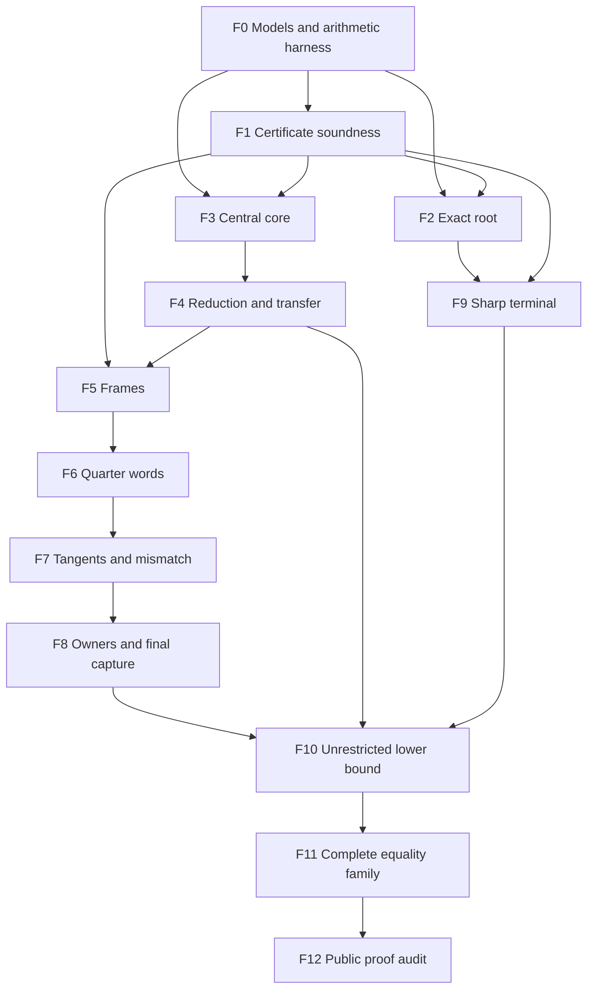

# Eight squares: staged Lean formalization roadmap

## 1. Scope and current status

This roadmap prepares the formalization of the unrestricted sharp-radius
theorem for eight unit squares, together with the complete equality
classification. It does not start a Lean implementation, run Lean, or run
CI. A completed hand proof and a completed Lean proof are different
milestones. The former is the input to this plan; no new Lean theorem is
claimed by this document.

The canonical mathematical source is
[UNRESTRICTED_EIGHT_SQUARE_HAND_PROOF.md](UNRESTRICTED_EIGHT_SQUARE_HAND_PROOF.md).
Its fixed arithmetic appendices are identified by
[UNRESTRICTED_EIGHT_SQUARE_HAND_MANIFEST.json](UNRESTRICTED_EIGHT_SQUARE_HAND_MANIFEST.json).
The source snapshot before the cleanup is commit
`2dfee8a55617ebd4b96a57f5167603dda2f1e54d`, with these SHA-256 bindings:

| Source | SHA-256 |
|---|---|
| Main hand proof | `a69a1d897fad1c144fd1931a09bb1e464cbaed9054d273151d37645225e277fc` |
| Main hand manifest | `19f3992f5ade2de3b5962e920997277a98b95194f818739e6ee55ea42dfb7833` |

The manifest identifies 84 direct source files and 15 completed child
manifests. Its pending mathematical gate list is empty. These facts are
provenance for selecting formalization inputs; neither a hash nor a
`PASS` field proves a proposition in Lean. The consolidated proof and
its active dependency ledger determine which component hypotheses are
discharged. Earlier frozen notes may retain historical status wording.

**Repository baseline.** The current source tree pins
`leanprover/lean4:v4.35.0-rc3`, requests the mathlib tag
`v4.35.0-rc3`, and locks mathlib at
`c55e6e786f49471c72fbddbec5415808896aec1e`. The inspected tree has no
`SquaresInCircles/Eight` directory or other `Eight*.lean` file. This
preparation therefore claims no existing n=8 formalization. Stage F0
must match the actual existing geometry definitions and theorem
interfaces before choosing imports; compatible repository definitions
should be reused through proved adapters. The new module and declaration
names below are proposed work interfaces.

The following existing interfaces were read from that snapshot; none
was compiled during this preparation.

| Existing source | Reuse and adaptation needed |
|---|---|
| `SquaresInCircles/Geometry.lean` | `Point := ℝ × ℝ`, `normSq`, `UnitSquare`, `openSquare`, `closedSquare`, `Packing` and `Congruent` are the public model. `Packing` takes a nonnegative radius `R`; the hand proof's `q` is `R^2`. |
| `SquaresInCircles/Common/Basic.lean` | Reuse `frameX`, `frameY`, `rotate`, `InteriorDisjoint`, `phi_le_of_contained`, `Packing.phi_le` and frame identities. |
| `SquaresInCircles/Common/Separation.lean` | `support_separator` already turns actual nonoverlap into a support-normal witness. |
| `SquaresInCircles/Seven/SeparatingAxes.lean` | Despite its namespace, `Seven.SAT.separating_axes` is a general two-square theorem with only interior disjointness assumed. Adapt its four unsigned axes to explicit signed witness records. |
| `SquaresInCircles/Common/Charts.lean`, `Coordinates.lean`, `AngularBudget.lean` | Real-angle charts, coordinate conversion, and open/closed arc budgets are available. Inspect their precise connected-arc hypotheses before using them for the n=8 sum over all components. |
| `SquaresInCircles/Common/Optimum.lean` | `Optimum n` supports a set of models, proves `isLeast`, and supplies `packing_iff` and rigid witnesses. The intended final object is `Eight.optimum : Optimum 8`, using a family of models rather than `Optimum.ofUnique`. |
| `SquaresInCircles.lean`, `Challenge.lean`, `AxiomAudit.lean` | Public exports currently cover only `1 ≤ n ≤ 7`. `optimalRadius 8 = 0` and `optimalPackings 8 = ∅` are out-of-range defaults, not n=8 results. `Challenge.lean` is an intentionally unproved statement mirror; proof dependencies come from the library, not those challenge stubs. |

Two model details are mandatory. First, the product-space norm on
`ℝ × ℝ` is the maximum norm, so use `normSq` for Euclidean distance
or prove an explicit adapter to a Euclidean-space type before invoking
norm-based geometric results. Second, current `Congruent` allows a
rotation about the disk center and relabeling; it does not include an
orientation-reversing isometry. The n=8 proof uses reflection. Preserve
the shared meaning of `Congruent` and define the eventual n=8 model set
to include both the canonical admissible family and its reflected image.
Prove the reflection/rotation decomposition and its equivalence to the
hand statement up to all Euclidean isometries. This finite reflection
tag introduces no additional continuous freedom.

The proof-facing n=8 module can initially import the existing geometry
without changing the public range. Before the final unified export,
settle the dependency of the new exact constant and model definitions
on the pure statement layer. `Geometry.lean` cannot import a proof
module that already imports `Geometry.lean`. Keep the stationary
predicate/selection definitions in a pure definition layer if needed,
and prove their existence and uniqueness in F2. A definition using
classical selection is acceptable only with that subsequent proof;
it must not be replaced by a new existence axiom. This import decision
belongs to F0 and must preserve the statement mirror discipline.

## 2. Final public theorems

The final entry module must export the following mathematical statements.
The names in the first column are proposed labels for coordinating work.
They are not declarations or temporary axioms.

| Proposed theorem | Required statement |
|---|---|
| `sharpData_existsUnique` | There is a unique admissible stationary solution of main equations (1.1)–(1.3), including the positive radical branches and all domain inequalities. |
| `eight_squared_radius_lower_bound` | For every containing center, every nonnegative squared radius `q`, and every eight unit squares with pairwise disjoint open interiors contained in that disk, `q_star ≤ q`. No orientation, contact, core, word, owner, or neighborhood hypothesis remains. |
| `eight_sharp_packing_exists` | There is an actual eight-square packing in the disk of squared radius `q_star`. |
| `Eight.optimum` and `eight_optimal_radius` | Build an `Optimum 8` with the explicit model family and its reflected image; its radius is `sqrt q_star`. Reuse the generic `Optimum.isLeast` after supplying and proving all required fields, while retaining the direct unrestricted lower bound as a separate theorem. |
| `equality_iff_family` | A packing in the sharp disk is, up to Euclidean isometry and permutation of its eight squares, exactly a configuration from the explicit domain in main (12.7). Prove necessity and sufficiency separately before the equivalence. |
| `equality_box_is_admissible` | Every parameter in the exact rational box (12.8) belongs to that domain. |
| `equality_box_noncongruent` | Distinct parameter choices within that box give noncongruent packings, even allowing isometries and relabeling. |
| `q_star_hand_bracket` | The exact rational lower and upper bounds of main (1.6) hold. This is a consequence of the selected root theorem, not its definition by a numerical approximation. |

The equality theorem must preserve the actual result: the stationary
root, five normalized exterior anchors, and two exterior orientation
groups are rigid; the complete equality family has five genuine free
coordinates. Global injectivity of every boundary representative in
(12.7) is not required or asserted. Noncongruence is proved on the
specified full box. A theorem asserting a unique isolated optimal pose
would formalize a false target.

Intermediate lemmas may have explicit hypotheses corresponding to a
later stage. They must be labeled conditional and proved from those
hypotheses. They may not be introduced as axioms or mistaken for the
unrestricted final theorem. Stage F12 checks that the public theorem
statements contain none of those conditional inputs.

## 3. Shared mathematical interfaces

Agree on these interfaces in F0 before dividing the implementation.

### 3.1. Actual squares and packings

Use the repository's coordinate plane, squared Euclidean distance and
unit-square model. Prove the existing model equivalent to the square
with center `p`, orthonormal frame `(e,f)`, and points
`p + a e + b f` for `|a|, |b| ≤ 1/2`. The corresponding strict
inequalities describe its open interior. A packing is a family indexed
by eight labels with pairwise disjoint open interiors. Closed boundary
contacts are permitted.

Prove the corner criterion for disk containment, translation and
orthogonal-isometry invariance, equivalence of quarter-turn frame
representatives, and the full signed separating-axis theorem. Keep the
four geometric axis directions distinct from their eight signed
orientations. An arbitrary feasible signed separator must be available
as a witness; later exclusions concern every forbidden feasible axis,
not just the existence of one convenient allowed axis.

### 3.2. Boundary neighbor cycles

A boundary cycle has seven exterior square records, cyclic order,
explicit real center-angle lifts, true frames, and one retained original
signed witness on each neighboring edge. Each vertex carries either an
outer (`O`) or core (`C`) boundary state. Core side and core corner
subtypes and every shared endpoint are represented explicitly.

Keep the semantic layers separate:

- An actual eight-square packing satisfies all 28 pair conditions.
- A relaxed seven-square boundary cycle needs its seven neighboring
  conditions and the core/containment conditions. Nonneighbors may
  overlap after deformation.
- The initial boundary deformation preserves true frames and retained
  witnesses; it need not preserve center rays or relative tangents.
- Outward radius expansion preserves true frames, rays, relative
  tangents and every initially feasible signed axis.

The type and theorem signatures must expose the radius level. Use
`q_minus = 7831/2000`, `Q1 = 1957767069/500000000`, and
`Q0 = 9789/2500` as exact real casts of rationals. Avoid an implicit
global radius parameter shared by lemmas that prove different scopes.

### 3.3. Candidate coordinates and equality data

Use the role order `(H,G,A,B,T,D,E)`, candidate word `0101011`, and
the four original margins in main (7.2). Define the five-edge mismatch
`S = sum |d_i|` over `I = {0,2,3,4,5}`. The two mixed edges remain
uncharged and retain their full angle ranges unless a specific proved
lemma says otherwise.

Define admissible stationary data independently of any packing reduction.
Either make the positive radical `v` branch explicit and prove its
equivalence to (1.1), or formalize the implicit branch with its existence,
uniqueness and derivative lemmas. In either representation, prove domain
positivity before using square-root derivatives or clearing denominators.
Use the proved existence theorem to identify the selected `q_star`;
choosing that object is a definition, not an additional assumption.

An equality parameter record has exactly `(x,y,w,z,eta)`. Its membership
predicate is the explicit conjunction of main (12.7), including the
half-open fundamental interval for `w`, both slider intervals, the two
strict central-core inequalities and the seven weak maximum inequalities.
Do not replace this predicate by an existential packing predicate.

## 4. Finite stage ledger

All F-stage gates below are formalization work to be discharged. The
hand results they reference have already been supplied. A stage is
complete only when its declared Lean outputs meet the exit conditions;
an uncompiled draft receives the separate status `draft`, not `closed`.
Compiler-based gates belong to the later authorized implementation pass.

| Stage | Deliverable | Depends on | Exit gate |
|---|---|---|---|
| F0 | Repository adapters, precise models and a small arithmetic feasibility harness | Pinned source inventory | Shared definitions agreed; model equivalences proved; a representative rational/polynomial derivation can be checked with the intended trusted method. |
| F1 | Generic scalar, polynomial, arc-row and closed-cover soundness | F0 | A checked finite table implies its complete continuous inequality; all support modes, reversals and endpoints are covered. |
| F2 | Exact stationary root, admissible uniqueness, constants and sharp bracket | F0; F1 for finite comparisons | Unique data exist with positive radicals and all stationary/curvature/weight bounds used later. |
| F3 | Central square and open radius-`1/12` core | F0; F1 for fixed polynomial lemmas | The unrestricted eight-square hypotheses below `Q0` imply exactly one central square and the strict core statement. |
| F4 | Boundary reduction and outward radius transfer | F0, F3 | All original selected witnesses and true frames survive reduction; expansion has its stronger preservation theorem; all `2^7` radial words remain covered. |
| F5 | Four-type pair lemmas and frame concentration | F1, F4 | Whole-pair hypotheses imply the complete seven-cycle bound and real frame lifts with range `< 7/10`. |
| F6 | Quarter-word classification and all six exclusions | F1, F5 | Every permitted cycle, up to the proved dihedral normalization, has word `0101011`. |
| F7 | Tangent cuts and mismatch through `S < 3/200` | F1, F6 | Six tangent cuts, coarse contraction, middle contraction, sign bootstrap and next contraction have their exact ordered interfaces. |
| F8 | Quarter owners, last contraction, mixed owners and tilt | F1, F7 | All feasible owners are in (10.4), `S < 1/1000`, and `1/10 < t < 4/25`. |
| F9 | Exact center completion and automatic-slider terminal | F1, F2, F0 models | The quantitative inequality (10.6) holds for arbitrary admissible centers under the stated conditional frame/owner hypotheses. |
| F10 | Unrestricted lower bound | F2–F9 | The public lower-bound theorem has only actual packing and containment hypotheses. |
| F11 | Original-position equality, full converse and five freedoms | F2, F3, F4, F8, F9; F10 for noncongruence | Both directions of (12.7), attainment, and the injective box theorem are proved. |
| F12 | Public theorem assembly and dependency audit | F10, F11 | The pinned project checks; exported proofs contain no placeholder, extra geometric axiom, unchecked certificate or conditional capture assumption. |

The topology below is an implementation dependency view. The ordered
subgates inside F7 and F8 are mandatory even when their table arithmetic
is prepared in parallel.

### F0 — Models and an early arithmetic feasibility gate

First inventory the pinned project. Locate the actual square, packing,
circle, rotation and nonoverlap definitions and prove adapters only where
needed. Record any existing theorem proposed for reuse together with its
exact statement and dependency audit. A file with a relevant name is
not evidence that its theorem supplies the needed assumptions.

Create a small representative proof harness before generating the large
data modules. It should include a nonnegative rational comparison, a
strict polynomial Bernstein bound, a radical bracket, one circle-support
row, one side/corner endpoint, a reversed original axis, and a closed
angle union with a singleton boundary case. Use the same intended
arithmetic architecture that will later check the complete tables.
Record term size, checking time and memory at this modest scale only.
No claim that the full tables will fit follows from the small trial.

**Exit.** The model identifies actual set packings correctly; the trust
path of the harness is explicit; the implementation team can decide
between reasonable proof-producing arithmetic representations before
committing to a huge generated term format. This is the first integration
commit, not a gate postponed until all geometry has been transcribed.

### F1 — The continuous theorem behind finite data

Formalize rational interval soundness, exact polynomial evaluation and
the Bernstein convex-combination identity on a closed interval. Supply
separate weak and strict variants. Prove sine/cosine Taylor remainder
bounds with their stated range assumptions, rational square-root
brackets, and the necessary Machin/arctangent comparisons for `pi`.

Next prove the three state-elimination modes: affine endpoints on a
straight side, derivative/concavity endpoints on an arc, and full-circle
support. Formalize the radical majorant identity in main (8.3), including
its positive parameter and nonnegative radicand hypotheses. Prove the
axis reversal/reflection formulas with the correct transformed markers.
The original edge charge must remain attached to the original edge.

The principal generic interface is:

> A row that passes the proved arithmetic predicate implies its stated
> strict charged-pair inequality for every real state and angle in that
> row's exact domain. A table whose valid rows cover every permitted
> state/sign/original-axis/angle domain implies the whole-pair theorem.

Closed-cover soundness is a separate theorem. It must establish the
union of rational angle intervals, rational tangent arcs, core side and
corner domains, and all allowed original axes. Outward rounding of a
geometric endpoint may enlarge a cover; inward rounding must not silently
lose part of the necessary domain. Retain zero-length closed intervals
and weak boundaries. Choose each vertex's marker once for both incident
edges, including type and sign ties.

**Exit.** Instantiate the theorem for one complete original-axis chain
in addition to the F0 examples, and verify the expected failure of the
predicate after a coefficient, required axis or covered endpoint is
removed. Such diagnostic checks test the implementation; the proved
soundness theorem remains the mathematical basis of every accepted row.

Principal sources: `AFFINE_ARC_ONE_ANGLE_HAND_KERNEL.md`,
`AFFINE_MARKER_SUPPORT_REDUCTION.md`, and
`CONDITIONAL_AFFINE_ARC_KERNEL_INDEPENDENT_AUDIT.md`.

### F2 — Exact root and stationary data

Prove the admissible five-corner family, the complete position convexity
argument, positivity of reduced tilt curvature at every relevant critical
point, and strict monotonicity of the minimized defect with radius.
Prove existence and uniqueness of the stationary zero on the full stated
domain; a local interval root is insufficient for this interface.

Then establish `q_minus < q_star < Q1 < Q0 < 4`, the stronger hand
bracket, all positive radical bounds, the tilt enclosure, and the
positive contact/vertex weights and force identities required by F9.
Formalize the equivalence of the two coordinate systems used by the
family and equality notes, rather than identifying their variables by
similar names. The eight square-root brackets and two explicit test
poses supplement the global family proof; they cannot replace it.

**Exit.** The exact data record is inhabited uniquely, all divisions and
derivatives have proved domain hypotheses, and all later terminal
constants are consequences of that same record. No solver-produced
floating root or externally asserted Hessian sign appears in the proof.

Sources: `HUMAN_FIVE_CORNER.md`, `HUMAN_FAMILY_ENCLOSURE.md`,
`HUMAN_FAMILY_CLOSURE.md`, `HUMAN_BROAD_TERMINAL_ARITHMETIC.md`, and
`HUMAN_SHARP_CEILING_BRACKET.md`.

### F3 — Unrestricted central existence and the positive core

Formalize the circular angular measure of a square, including all
components when its intersection is disconnected. Prove that square
boundaries contribute measure zero, so eight interior-disjoint squares
have total measure at most `2*pi` on each test circle. Prove the
one-square inequality `3 L_1 + L_(5/4) ≥ pi` and its equality cases.
The summed equality contradiction supplies central existence and
uniqueness for actual squares.

Prove the center-translation depth improvement, the three polynomial
common-point lemmas, connectedness of the forbidden direction interval,
and both exact angular-budget contradictions. The output is the strict
statement that the closed radius-`1/12` disk lies inside the central
square's open interior. Derive strict positive distance of every other
closed square from this disk by compactness.

**Exit.** No central square, positive core, connected arc, or canonical
noncentral case is assumed. Every such conclusion follows from the
original packing at `q ≤ Q0`. Circle-side tangencies and disconnected
circle intersections are included.

Sources: `HUMAN_GLOBAL_GEOMETRY_CLOSURE.md`,
`HUMAN_CENTRAL_CORE_FROM_TRANSVERSE_SEGMENT.md`, and
`CENTRAL_BAND_COMMON_POINT_LEMMAS.md`.

### F4 — Witness-preserving reduction and radius transfer

Prove the initial center radius/gap bounds and existence of cyclic
arguments. Formalize the common recession direction of two selected
halfplanes and the first boundary contact with the compact outer center
body or the forbidden core body. A finite induction over seven vertices
produces an `O/C` boundary cycle. Prove that no neighboring center rays
cross and no directed gap reaches `pi` during the motion.

Separately prove the explicit outer radius equation and derivative
bounds on `[5/2,4]`. Establish the positive derivative of each initially
feasible signed separator and use the first-crossing argument to prove
outward preservation. This theorem must quantify over every initially
feasible signed axis, including simultaneous owner ties.

**Exit.** The output record contains the relationship to the original
frames and witnesses. It covers all 128 radial words. Recovery of an
earlier lower-radius cycle uses its stored feasibility; no theorem of
arbitrary inward separator preservation is introduced.

Sources: `CYCLIC_RADIAL_BOUNDARY_REDUCTION.md` and
`HAND_FIXED_CEILING_TRANSFER_WITH_AUTOMATIC_TERMINAL.md`.

### F5 — Whole-pair frame bounds and real lifts

Prove the common-point center-gap bound and eliminate the four backward
signed axes. Implement the ten complete `C/L/M/H` pair arguments and
their fixed arithmetic. Then prove the four-type seven-walk lower bound,
the cyclic marker cancellation, the orientation-circle variation bound,
existence of real frame lifts, and the strict range `D < 7/10`.

The seven-walk fact has both a short odd-walk argument and 16,384 finite
instances. Either can be formalized, provided the Lean theorem covers
every seven-step closed walk. Its finite proof does not replace the ten
continuous pair theorems. Endpoint marker choices must be consistent
at each vertex.

**Exit.** The frame theorem has the boundary-cycle and radius hypotheses
actually used by the hand proof. F4 transfers it from `Q0` to the
already feasible `Q1` cycle without changing the proved angular data.

Sources: `FOUR_TYPE_HAND_COVERAGE_INVENTORY.md`, its ten whole-pair
appendices, `HAND_EXTERIOR_FRAME_CONCENTRATION.md`,
`HUMAN_CIRCULAR_CAP_AND_AXIS_ELIMINATION.md`, and
`COMMON_POINT_AND_THREE_QUARTER_ANGLE.md`.

### F6 — Complete quarter-word classification

Define the integer quarter lifts, prove their sum is four, establish the
digit/range and zero-run restrictions, and prove that all 70 admissible
ordered words fall into exactly the seven stated dihedral classes.
Keep the dihedral action explicit so all role/sign transformations can
be checked.

Formalize the common three-increment table excluding the four words
with a 2, then the full `0010111` and `0011011` exclusions. The first
short wrong-word proof includes all 304 retained-axis cases; the second
includes the 76 pair cases and the corresponding 304 axis cases. Each
continuous scope and every reflection identity must be supplied, not
inferred from a smaller set of sampled representatives.

**Exit.** At `Q1`, after the legitimate temporary expansion to `Q0`,
the only quarter word up to the proved normalization is `0101011`.
No radial necklace restriction is part of this result.

Sources: `SEVEN_QUARTER_WORDS.md`,
`COMMON_QUARTER_TABLE_AND_FOUR_WORD_EXCLUSIONS.md`,
`SHORT_WRONG_WORD_COMPLETE_HAND_EXCLUSION.md`, and
`WRONG_0011011_WHOLE_WORD_HAND_PROOF.md` with their component manifests.

### F7 — Candidate cuts and the first three mismatch levels

Implement the following finite ordered subgates. Arithmetic generation
may be parallel; the theorem dependency order may not be changed.

| Subgate | Exact output | Scope that must remain in the theorem |
|---|---|---|
| F7.1 | Reflection allows `u_E ≤ 0`; G lies in `(-4/5,-1/20)` | Both radial kinds and all original axes. Reflection reverses indices by `i ↦ 5-i` and changes signed tangents. |
| F7.2 | T lies in `(1/20,4/5)`; H is `> 1/2`; D is `< -1/2` | Use only the previously proved G/T/E domains declared by each table. |
| F7.3 | `S < 2/5`, then `S < 13/50` | Coarse table uses G/T/E only and all four axes. Prove the retained printed reserves as lower bounds on every original edge's cost; their units must match the unscaled inequality. |
| F7.4 | Zero-quarter axes 2 and 4 are impossible | Follows from the proved `S ≤ 2/5`; it is not an input to the coarse theorem. |
| F7.5 | `S ≤ 13/50 → S < 1/10` | All four axes on every edge; both A/B signs. H/D strong cuts are available. |
| F7.6 | H/A/T positive and G/B/D negative | Prove only after `S ≤ 1/10`, including zero-tangent boundary exclusions. |
| F7.7 | `S ≤ 1/10 → S < 3/200` | Both radial kinds, all original axes and full mixed-edge signed ranges. |

Prove the shared cyclic charged-cost identity once. Use monotonicity
and concavity of `h(x) = (sin x + cos x - 1)/2` on the stated positive
interval to obtain `sum h(|d_i|) ≥ h(S)` only when its total-range
hypothesis is available. The initial coarse bound uses the separate
endpoint chord. Exact rational strict reserves, rather than decimal
rounding, close each contraction.

**Exit.** Each table has both a sound arithmetic theorem and complete
domain-cover theorem, and all preceding hypotheses are supplied in the
assembler. In particular, F7.5 must not accidentally import the signs
it is needed to prove.

Sources: the six tangent manifests; `CANDIDATE_COARSE_MISMATCH_HAND_MANIFEST.json`;
`COARSE_MISMATCH_PRINTED_RESERVE_MANIFEST.json`;
`MISMATCH_026_TO_01_AFFINE_HAND_MANIFEST.json`;
`MISMATCH_01_TO_015_AFFINE_HAND_MANIFEST.json`; and
`HAND_CANDIDATE_MISMATCH_BOOTSTRAP.md`.

### F8 — Last contraction, all owners and tilt

First prove the 1,545 fixed quartic comparisons excluding the 48 bad
quarter-owner patterns under `S ≤ 3/200`. This leaves axes 3/4 on
B→T and D→E. Both mixed edges still allow all four original axes.

Next instantiate the final mismatch table to prove
`S ≤ 3/200 → S < 1/1000`. This is the first contraction allowed to
use the established zero and other-quarter owner restrictions. It may
not assume either desired mixed owner or the final tilt interval.

Then prove the 729 fixed quartics excluding the 15 bad mixed-owner
patterns and the 1,239 quartics for tilt. For the tilt proof, choose one
common seven-edge multiplier vector on each of its 59 intervals before
maximizing over the 21 signed-error/owner alternatives. Formalize the
global width semiconvex bound, its cusp slopes and the `l1` error-vertex
reduction. Choosing different multiplier vectors after selecting the
error alternative would not prove the supplied argument.

**Exit.** Every feasible original signed axis belongs to
`{1,3},{1},{1,3},{3,4},{1,3},{3,4},{2}`, and the same actual frame
variable satisfies `1/10 < t < 4/25`. The 32 terminal owner choices
are mapped by the exact quarter offsets `(-1,-1,0,0,1,1,2)`.

Sources: `MISMATCH_015_TO_001_AFFINE_HAND_MANIFEST.json`,
`CANDIDATE_CAPTURE_AT_ONE_THOUSANDTH_HAND_MANIFEST.json`, and its owner,
signed-error and tilt appendices.

### F9 — Conditional sharp terminal for arbitrary centers

This stage can be developed before candidate capture has been assembled.
Its hypotheses are explicit: seven unit squares in the disk of squared
radius `q ≤ Q0` avoiding the open radius-`1/12` disk, A's actual frame
normalized to zero, G's frame equal to `t`, canonical quarter offsets
`(-1,-1,0,0,1,1,2)`, the stated allowed owner choices,
`S ≤ 1/1000`, and `1/10 ≤ t ≤ 4/25`.
It must not require centers to lie on boundary curves or close to the
stationary centers.

Prove the five-center completion identity, positivity and normalization
of the stationary weights, the automatic projection bounds for both
sliders, all 32 first-order reserves, and the quadratic loss bound.
Derive the exact terminal inequality (10.6), including its nonnegative
center squares, positive tilt term and positive mismatch coefficient
`10293/5000000`. Separately record the zero-frame-error dual identity
(11.3), with vanishing slider forces, for later evaluation at the
original centers.

**Exit.** Equality in the conditional terminal forces `S = 0` and
`t = t_star`. The stronger original-position identity can be applied
without a bound on how far any original center moved.

Sources: `HAND_EXACT_CENTER_SQUARE_COMPLETION.md`,
`HAND_TERMINAL_WITH_AUTOMATIC_SLIDERS.md`, and the stationary arithmetic
from F2.

### F10 — The unrestricted lower bound

Write the short assembler only after the interfaces agree. For an
actual subsharp packing, enlarge the containing disk to
`q_bar = max q q_minus < q_star`, perform F3/F4 reduction at that
radius, expand to `Q1`, and expand temporarily to `Q0` for F5/F6.
Apply F7/F8 at `Q1` to the unchanged relevant angular quantities.
Recover the particular previously feasible `q_bar` cycle. Its retained
original axes belong to the final allowed owner sets because they
remained feasible at `Q1` and F8 excludes every forbidden feasible
axis. Apply F9 at `q_bar` and derive a contradiction.

**Exit.** Inspect the final theorem type and its full dependency
closure. There is no leftover conditional root-existence, central-core,
boundary-kind, frame, word, tangent, mismatch, owner, slider or tilt
assumption. Passing a table replay is not the exit gate of this stage;
the actual unrestricted theorem is.

### F11 — Equality necessity, converse and five dimensions

Prove three distinct results and keep their dependencies visible.

1. **Necessity for original squares.** Starting at `q_star`, obtain
   `S = 0` and `t = t_star` from the recovered boundary cycle. Transfer
   those true-frame statements to the original packing. Reapply the
   exact stationary dual to the original centers and original witnesses.
   The positive weighted squared displacements and contact gaps vanish.
   This fixes A/B/D/E/H and the longitudinal coordinates of T/G.
2. **Full parameter-domain converse.** Derive the exact slider ranges,
   prove all 21 exterior pair separations, and prove the seven central
   maximum inequalities equivalent to actual separation. Include the
   central half-angle frame interval, strict core condition, weak slider
   endpoints and all contact ties. This proves that domain (12.7) is
   necessary and sufficient and supplies an actual sharp packing.
3. **Five independent freedoms.** Prove the exact rational box (12.8)
   lies in the domain with the stated strict reserves. Prove that an
   isometry and relabeling between two configurations in this box must
   fix the unique containing circle, five boundary anchors and role
   assignments, hence all five coordinates. Combine with F10 where
   the least-radius argument is used. Merely exhibiting five variable
   symbols would not establish five noncongruent freedoms.

**Exit.** Export necessity and sufficiency as separate theorems, their
equivalence, attainment, and the injective-box statement. The central
square may rotate through the full permitted domain; it is not assumed
to share either exterior frame.

Sources: `EQUALITY_PULLBACK_TO_ORIGINAL_SQUARES.md` and
`COMPLETE_EQUALITY_PARAMETER_DOMAIN.md`.

### F12 — Public assembly and trust audit

Use the pinned project to check every stage and the final public import
module in the later authorized verification pass. Inspect the axioms
of all public theorem declarations. Only ordinary Lean/logical axioms
already admitted by the project are permitted; no new geometry,
certificate, optimizer or native-evaluation correctness axiom is allowed.
Review any axiom outside the established baseline explicitly rather than
accepting an empty source-text search as an axiom audit.

The expected standard logical axiom names are `propext`,
`Classical.choice`, and `Quot.sound`; some individual theorems may
depend on fewer. Any additional reported axiom requires an explicit
explanation and cannot serve as an unproved mathematical or computational
step of this formalization.

The final dependency closure must contain no `sorry`, `sorryAx`,
`admit`, unproved theorem stub, or trusted external boolean. An external
program can generate Lean data or proof terms, but Lean must validate
what that data or term means. A file hash can identify the source that
was used; it cannot establish its inequalities. Record the checked
toolchain, mathlib revision, final theorem names, actual compiler result
and exact verification time. Only this result closes formalization.

## 5. Large-table implementation policy

Several supplied tables contain more than 100,000 rows and millions of
rational coefficient comparisons. Treat proof-term size and arithmetic
checking cost as an engineering risk to resolve at F0/F1. Do not assume
that a single monolithic `decide` will check them within practical
resources.

The intended trust boundary is:

1. A pure finite-data representation encodes rational numbers, row
   hypotheses, arc identifiers, original axes, polynomials and interval
   covers.
2. A Lean theorem proves that the finite row predicate and complete
   cover predicate imply the real geometric statement.
3. Each actual predicate instance is discharged by proof-producing
   arithmetic or kernel-checked reduction, in deterministic bounded
   chunks. The tactic or generator may be untrusted because its output
   is a proof term checked by the kernel.
4. A short finite aggregation theorem joins the chunks and proves
   every required row/domain is covered. It checks exact indexing,
   counts and endpoints rather than assuming that all files were listed.

Do not use `native_decide` or another native/external-evaluation bridge
whose result enters the proof through an additional correctness axiom.
If ordinary reduction is too costly, change the proof-producing
arithmetic representation, share repeated lemmas and rationals, or
generate smaller proof terms. Keep the trust boundary unchanged.
The final axiom report is the deciding check for the selected mechanism.

Generated source should be deterministic and associated with a schema
version, source manifest, row interval and generator revision. The
existing multipart inputs must first be reconstructed byte-for-byte
using their supplied restorers. The compiler must then see the actual
data being proved, not just a reference to a JSON file or its SHA-256.
Do not parse JSON through an unverified run-time operation and treat its
returned propositions as facts.

The compact reports are useful for checking a transcription against the
research replay. Formal proofs still derive the geometric inequality
from the row expression, premises and supplied coefficient bounds.
They must not merely prove that an imported list of positive numbers
is positive. Likewise, an all-positive row list cannot imply coverage
without the separate cover proof.

## 6. Parallel assignments and integration rules

The following proposed source layout makes ownership concrete. Every
path in this table is future work, under `SquaresInCircles/Eight/`;
this preparation creates none of these files.

| Proposed module group | Contents and owner |
|---|---|
| `Model.lean`, `SeparatingAxis.lean` | Actual-square adapters, signed witness semantics, boundary/candidate records; shared F0 owner. |
| `Arithmetic/` | Rational and polynomial soundness, Taylor bounds, radical bounds, affine-arc support, closed covers; arithmetic lane. |
| `Generated/` | Deterministic finite table chunks and proved aggregation statements; arithmetic lane. |
| `ExactFamily/` | Admissible root definition, family uniqueness, rational brackets, stationary weights and force identities; exact-family lane. |
| `CentralCore.lean`, `BoundaryReduction.lean`, `RadiusTransfer.lean` | Unrestricted geometry and preservation theorems; geometry lane. |
| `Frames.lean`, `QuarterWords.lean` | Whole-pair assembly, real lifts and complete finite word exclusions; geometry lane with arithmetic support. |
| `Candidate/` | Tangent cuts, ordered mismatch chain, owner exclusions and tilt; geometry lane integrates completed table theorems. |
| `Terminal.lean`, `Equality.lean` | Arbitrary-center terminal, original-position necessity, explicit family converse and injective box; exact-family lane. |
| `Theorem.lean` | The unconditional public lower bound, attainment and classification statements; integrating reviewer. |

Update the repository's existing root export and axiom-audit modules
only in the later authorized implementation, after these interfaces are
proved and the established export conventions have been inspected.
At that point add the n=8 definitions to the pure statement layer,
extend the public range to eight, and regenerate `Challenge.lean` using
the established `scripts/verify-comparator.sh --write` workflow. The
source explicitly requires that mirror to elaborate identically to
`Geometry.lean`; do not hand-edit independent competing definitions.
Run the comparator and updated axiom audit only in the authorized
verification pass.

After F0, use at most three implementation lanes plus the integrating
reviewer. The lane boundaries are mathematical interfaces, so a lane
can finish a conditional theorem while another prepares its premises.

| Lane | Main ownership | First useful deliverable |
|---|---|---|
| Arithmetic and finite tables | F1; generated row modules; most table instances in F5–F8 | A proved complete one-axis chain using the final row/cover format. |
| Unrestricted geometry and assembly | F3, F4, frame lifts in F5, word enumeration in F6, ordered F7/F8 integration, F10 | The strict central-core theorem and a witness-preserving boundary-cycle record. |
| Exact family, terminal and equality | F2, F9, F11 | Unique stationary data and the force/weight identities needed by the terminal. |
| Integrating reviewer | Shared interfaces, selected existing-lemma reuse, dependency/axiom review and F12 | An agreed F0 model and a theorem-level dependency ledger. |

Once generic table soundness is stable, independent families of complete
tables can be assigned to whichever lane has capacity. Do not send all
workers to rewrite the same checker or the final assembler. Keep one
owner for each shared model and index convention. Review interface
changes before generating large dependent modules.

The next implementation session should finish F0, begin the analytic
part of F1, and start F2/F3 against the agreed interfaces. It should not
begin by translating the largest JSON table or by asserting the final
theorem with placeholder hypotheses.

## 7. Commits, timestamps and handoff records

Preserve [PRE_SQUASH_COMMITS.json](PRE_SQUASH_COMMITS.json) and
[PROGRESS_HISTORY.md](PROGRESS_HISTORY.md), which accompany this handoff.
It records old commit identifiers and their actual author/committer
times. Squashing changes the visible branch history; it does not change
when the earlier work occurred. Do not synthesize those times from file
modification times or from the new squash commit date.

For the later implementation, record one progress entry for each
meaningful theorem/module checkpoint with: stage/subgate, exact theorem
names, source appendix or manifest, current status (`planned`, `draft`,
`checked`, or `blocked`), commit SHA, exact author and committer timestamps,
verification timestamp, toolchain revision, and the unresolved
obligation if any. Save machine-readable ISO-8601 times in UTC and retain
the original timezone offsets when provided by Git. A human chronology
may additionally show America/Chicago time.

Commit small coherent results: the model adapters, a generic soundness
lemma, a complete table chunk with its aggregation theorem, an entire
geometric sublemma, or one discharged interface. A checkpoint does not
need to close a whole F stage, but its entry must state what was proved
and which assumptions remain. Continue using `[skip ci]` until CI is
explicitly authorized. Do not merge as part of the preparation pass.

## 8. Completion criterion

Formalization is complete when the actual unrestricted lower bound,
attainment, full equality equivalence and noncongruent-box theorems are
checked together under the pinned project, and their dependencies pass
F12. The present plan supplies a finite path to that outcome. It does
not give a completion-time estimate or guarantee that no missing library
lemma, proof transcription error or resource problem will be encountered.
Any such obstacle is attached to its concrete F-stage obligation; it
does not justify weakening the final theorem or silently replacing a
hand step with an axiom.
