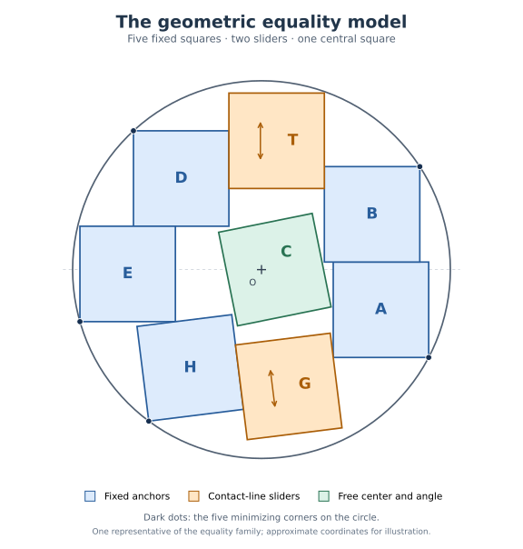

# The eight-square theorem in geometric form

Eight closed unit squares with pairwise disjoint open interiors require
a containing disk of radius at least \(R_*\). The bound is attained.
Every equality packing, up to an isometry and relabeling, consists of
five fixed exterior squares, two exterior sliders, and a central square
with a free center and angle. Sections 1--2 define the constant and the
complete family using only geometric constraints.

The proof is the completed table-free hand argument. Its exact arithmetic
certificates support the geometry; their radius enclosures are not part
of the model definition. The historical n=8 Lean source remains an
[uncompiled draft](STATUS.md).

## 1. The optimal radius is a five-corner minimum

For an angle t write
\[
 e_t=(\cos t,\sin t),\qquad f_t=(-\sin t,\cos t).
\tag{1}
\]
Consider five points \(X_A,X_B,X_D,X_E,X_H\) and
\(0\le t\le\pi/4\), subject to the five projection constraints
\[
\begin{aligned}
 (X_B-X_A)_y&\ge2, & (X_B-X_D)_x&\ge3,\\
 (X_D-X_E)_y&\ge2,\\
 e_t\cdot(X_A-X_H)&\ge2+\cos t, &
 f_t\cdot(X_E-X_H)&\ge1+\sin t.
\end{aligned}
\tag{2}
\]
Define
\[
 \boxed{\quad
 R_* = \min_{\substack{0\le t\le\pi/4,\ X_A,X_B,X_D,X_E,X_H\in\mathbb R^2\\
                       \text{the five constraints (2) hold}}}
                     \max_{i\in\{A,B,D,E,H\}}\|X_i\|.
 \quad}
\tag{3}
\]
Thus the radius is the smallest centered disk containing a five-point
chain with prescribed projection gaps. At any fixed tilt, the point
problem is convex: its constraints are halfplanes and disks. The
integers in (2) come from the unit-square contact widths.

The [five-corner model](EIGHT_SQUARE_FIVE_CORNER_MODEL.md) and its
[global selection proof](HAND_FIVE_CORNER_MODEL_SELECTION.md) establish
that (3) has a unique minimizing tilt and five-point configuration.
Denote them by \(t_*\) and \(X_i^*\). All five points lie on the
optimal circle and all five inequalities (2) are equalities. This
minimum agrees exactly with the previously constructed stationary
constant: \(R_*^2=q_*\). No radius bracket or small coordinate box is
needed to specify which solution the model means.

The model note also gives symmetric circle equations and a two-height
coordinate formula for algebraic evaluation. Those describe the fixed
minimizer; they do not add parameters to the packing family.

## 2. The complete geometric equality family

### 2.1 One containment function and one separation function

The unit square with center p and angle alpha is
\[
 S(p,\alpha)=p+[-1/2,1/2]e_\alpha+[-1/2,1/2]f_\alpha.
\tag{4}
\]
Its exact squared containment cost is
\[
 \mathcal C(p,\alpha)=
 (|p\cdot e_\alpha|+1/2)^2+(|p\cdot f_\alpha|+1/2)^2.
\tag{5}
\]
For two square angles, put
\[
 \operatorname{Sep}_{\alpha,\beta}(d)=
 \max_{n\in\{e_\alpha,f_\alpha,e_\beta,f_\beta\}}|d\cdot n|
 -\frac{1+|\cos(\alpha-\beta)|+|\sin(\alpha-\beta)|}{2}.
\tag{6}
\]
Containment in the centered radius-R disk means \(\mathcal C\le R^2\).
Two squares have disjoint open interiors exactly when their separation
margin is nonnegative. Both statements include boundary contacts.

### 2.2 Five fixed squares and two contact lines

Write \(e=e_{t_*}\), \(f=f_{t_*}\). Recover the fixed square
centers from the minimizing corner points:

| Square | Fixed center | Angle |
|---|---|---|
| A | \(P_A=X_A^*+(-1/2,1/2)\) | 0 |
| B | \(P_B=X_B^*+(-1/2,-1/2)\) | 0 |
| D | \(P_D=X_D^*+(1/2,-1/2)\) | 0 |
| E | \(P_E=X_E^*+(1/2,1/2)\) | 0 |
| H | \(P_H=X_H^*+(e+f)/2\) | \(t_*\) |

The two sliders are
\[
 P_T(z)=((P_B)_x-1,z),\quad \alpha_T=0,
 \qquad
 P_G(\eta)=P_H+e+\eta f,\quad \alpha_G=t_*.
\tag{7}
\]
T moves vertically between the two upright columns; G moves parallel to
f along its contact line with H. The central square is \(S(p,\theta)\),
where theta is its actual angle modulo \(\pi/2\).

### 2.3 The exact five-parameter domain

Choose
\[
 (p,\theta,z,\eta)\in
 \mathbb R^2\times\bigl(\mathbb R/(\pi/2)\mathbb Z\bigr)\times\mathbb R^2
\tag{8}
\]
subject to these geometric requirements:

* **The sliders lie in the sharp disk:**
  \(\mathcal C(P_T(z),0)\le R_*^2\) and
  \(\mathcal C(P_G(\eta),t_*)\le R_*^2\).
* **The whole T square lies above the horizontal axis, and the whole
  G square lies below it:**
  \[
    z\ge1/2,\qquad
    (P_G(\eta))_y+\frac{\cos t_*+\sin t_*}{2}\le0.
  \tag{9}
  \]
* **The origin is in the central square's interior:**
  \[
    \max\{|p\cdot e_\theta|,|p\cdot f_\theta|\}<1/2.
  \tag{10}
  \]
* **The central square separates from each exterior square:**
  \[
    \operatorname{Sep}_{\theta,\alpha_i}(P_i-p)\ge0
       \qquad(i\in\{H,G,A,B,T,D,E\}).
  \tag{11}
  \]

**Equality classification.** Every point of this domain gives an
eight-square packing with least enclosing radius \(R_*\). Conversely,
every equality packing has this form after an isometry and relabeling.
The exterior cyclic order is H,G,A,B,T,D,E.

The [geometric equality proof](EIGHT_SQUARE_GEOMETRIC_EQUALITY_MODEL.md)
shows that all 21 exterior pair separations follow automatically from
the fixed anchors and the two rails. Only the seven central pairs need
to be listed. Central containment is automatic as well: (10) gives
\(\mathcal C(p,\theta)<2\), whereas the horizontal gap three in
(2) gives \(R_*^2\ge9/4>2\).

This domain is exactly equivalent to the earlier core-based parameter
domain, including its weak contacts. It has five independent freedoms:
two central translations, one central rotation, and two exterior
translations. A whole five-dimensional set of pairwise noncongruent
packings is proved in the
[equality-family certificate](HAND_EQUALITY_FAMILY_WITHOUT_BRACKET_TABLES.md).
Four fixed circle contacts already force the displayed enclosing
circle to be the unique least one.

## 3. The lower bound and original equality use one working radius

Take any disk of radius R containing an original eight-square packing,
and translate its center to zero. If \(R>R_*\), the lower bound
already holds. Otherwise the unchanged packing is contained in the
radius-\(R_*\) disk. Perform the entire sharp boundary argument at
this exact ceiling.

### 3.1 Construct and classify a fresh boundary representative

The central-core theorem selects one central square and seven exterior
squares. Select one actual signed separating axis on every neighboring
exterior pair. The recession boundary construction preserves these
seven physical witnesses, the original square frames, core avoidance,
and cyclic order while producing core or outer states at \(R_*\).
It does not need to preserve individual center rays.

For the established global classifications, expand just those outer
states along their rays to the auxiliary fixed ceiling. This distinct
operation preserves every feasible signed axis, physical frame,
ray, signed tangent ratio, radial kind, and cyclic gap. The continuous
frame, word, and owner theorems give the canonical roles and all
feasible owner restrictions. Return to the already known feasible
\(R_*\) boundary states, carrying these classification facts.

At this exact radius, the
[complete primary-owner entry theorem](HAND_G5_GLOBAL_PRIMARY_OWNER_ENTRY_COMPLETE.md)
excludes every positive terminal and every genuine negative terminal.
The latter would cause a strict circle loss at a rigid H or D anchor.
The remaining hard class has stationary equality data. The
[original-owner pullback](HAND_G5_GLOBAL_PRIMARY_ENTRY_ORIGINAL_EQUALITY_PULLBACK.md)
shows that its hard witnesses were already valid at the untouched
boundary source and that all seven initially selected physical axes
have the stationary directions. In particular, the original squares
have the required physical frames.

These statements concern a necessary boundary system at the known
ceiling. They do not assume that the original containing radius R is
optimal. The detailed argument and its noncircular dependency order are
in [the sharp-radius assembly](HAND_SHARP_RADIUS_BOUNDARY_ASSEMBLY.md).

### 3.2 Apply the stationary identity to the original centers

Let \(p_i\) be the original centers of the five anchors, let
\(o_i\) be their selected actual corner offsets, and let
\(g_j\ge0\) be the seven original selected contact gaps. The
[stationary force theorem](HAND_TERMINAL_RESERVES_AND_SQUARE_COMPLETION_WITHOUT_TABLES.md)
provides positive masses and contact weights with
\(\sum_i\mu_i=1\). Its exact completion of squares is
\[
 \underbrace{\sum_i\mu_i\|p_i+o_i\|^2
                -\sum_j\lambda_jg_j}_{\mathcal D}
   =R_*^2+\sum_i\mu_i\|p_i-P_i\|^2,
 \qquad \mu_i>0,\quad\lambda_j>0.
\tag{12}
\]
Every \(p_i+o_i\) is an actual original vertex, so its squared
norm is at most \(R^2\). Every original gap is nonnegative. Hence
\[
 \boxed{\qquad R_*^2\le\mathcal D\le R^2\le R_*^2.\qquad}
\tag{13}
\]
This proves the lower bound and equality together. All five original
anchor displacements vanish, and every original selected gap is zero.
The zero-force G and T centers retain precisely their contact-line
freedoms. The original central square retains its actual center, angle,
and seven nonoverlap constraints. The geometric domain in Section 2
therefore gives exactly the original equality family.

There is no lower working cutoff, no \(\max(q,q_L)\), and no
separate small-radius case. The auxiliary ceiling is used for
classification only. All sharp entry transports use the single actual
containing ceiling \(R_*\), and (12) is reapplied to
the untouched original centers.

## 4. Supporting proofs and exact arithmetic

| Mathematical task | Proof |
|---|---|
| Define the radius without an enclosing numerical bracket | [Five-corner geometric model](EIGHT_SQUARE_FIVE_CORNER_MODEL.md) |
| Identify its global minimum with the stationary construction | [Global five-corner selection](HAND_FIVE_CORNER_MODEL_SELECTION.md) |
| State and verify every equality packing in physical coordinates | [Geometric equality model](EIGHT_SQUARE_GEOMETRIC_EQUALITY_MODEL.md) |
| Assemble the arbitrary-packing proof directly at the exact radius | [Sharp-radius boundary assembly](HAND_SHARP_RADIUS_BOUNDARY_ASSEMBLY.md) |
| Check each internal radius, core, and angle domain | [Auxiliary bounds and aliases](HAND_AUXILIARY_RADIUS_BOUNDS.md) |
| Follow the complete owner and scalar dependency chain | [Hand-proof roadmap](TABLE_FREE_GEOMETRIC_HAND_ROADMAP.md) |

The auxiliary rational bounds still certify derivative signs, positive
force weights, and the domains of the geometric transports. They are
proof constants, not extra model parameters. Their catalog distinguishes
physical radii, squared radii, corner coordinates, and the auxiliary
core and frame bounds.

The scalar certificates are symbolic inequalities on whole intervals
or rectangles. Their exact arithmetic does not replace the geometric
argument. No sampled minimum, angle mesh, numerical optimizer output,
large lookup table, or unproved small-mismatch premise is an acceptance
input to this hand proof. Its mathematical completion does not assert
Lean elaboration or kernel verification; see the
[current handoff](HANDOFF_2026_10_20.md) for that separate work boundary.
