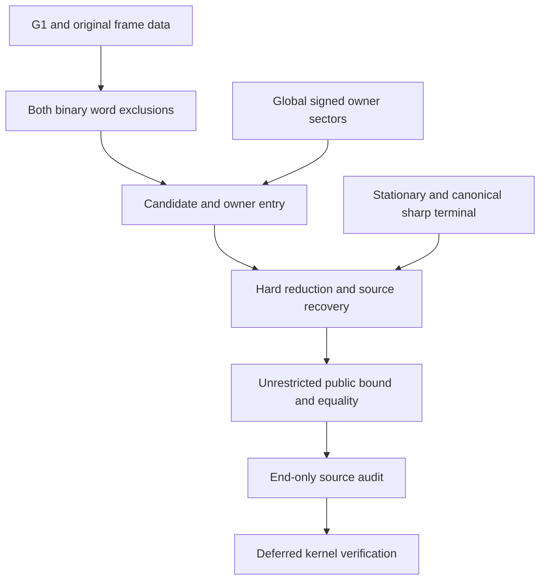

# Table-free formalization: live progress and remaining work

Updated **21 October 2026**. Branch: `formalize/eight-uncompiled-draft`.
Review: [PR #10](https://github.com/vltanh/lean4-squares-in-circles/pull/10).

**The unrestricted table-free formalization is not complete.** Substantial
continuous geometric components now have Lean source drafts, but the complete
word exclusions, global owner entry, original-source recovery, and public
theorem assembly are still open. The public theorem has not yet been replaced
by an unconditional table-free dependency chain.

This is the current implementation ledger. It supersedes the progress claims
and remaining-task lists in older handoffs and recovery snapshots. The older
[ROADMAP.md](ROADMAP.md) remains the detailed target specification; the
[table-free hand-proof roadmap](TABLE_FREE_GEOMETRIC_HAND_ROADMAP.md) remains
the mathematical source map. Neither a completed hand proof nor a previously
reported pre-disconnection draft establishes that its current Lean source is
complete.

The complementary [G0–G9 closure ledger](TABLEFREE_LEAN_CLOSURE_ROADMAP_2026_10_21.md)
records the aggregate acceptance criteria, particularly the original-source
`SharpSourceEntry` gate. Its intervening published documentation commits are
preserved in this branch; the detailed checklist below records later source
checkpoints against those gates.

## Status vocabulary and workflow

- **Drafted:** a concrete Lean proof body and its stated local interface have
  been written and checkpointed. This does not mean elaborated or checked.
- **Active:** a named implementation lane is extending the proof now.
- **Pending:** a required proof or integration step has not been completed.
- **Recovery/integration:** retained components exist, but missing older source
  and the complete aggregate interface still need reconstruction.
- **Deferred:** outside the present source-drafting pass.

No Lean, lake, typechecking, tests, CI, numerical sampling, native evaluation,
or certificate replay has been run in this continuation. The final source
audit is deferred until all drafting is complete. All publication commits use
`[skip ci]`. Root owns commits and publication; the three implementation lanes
do not publish independently.

The actual common radius, literal source points, original weak separating
axes, closed ties, and rigid-anchor strict-loss provenance must survive every
reduction. A conclusion-shaped assumption is not a substitute for a missing
entry theorem. In particular, a transport descendant does not establish that
its owners were feasible at the original source, and motion of the free G/T
points is not rigid-anchor loss.

## 1. Current milestone ledger

Lean paths below are relative to `SquaresInCircles/Eight/TableFree/`.

| ID | Component | Current state | Concrete scope / remaining boundary |
| --- | --- | --- | --- |
| M1 | Geometric stationary existence | **Drafted** | `GeometricStationaryExistence.lean` constructs stationary data from compact geometric minima, continuity and interior stationarity. Radius strip and ceiling are consequences. Final identification with the public designated sharp datum remains part of assembly. |
| M2 | Four-state frame pair geometry (G1) | **Drafted** | `FrameAllPairs.all_pair`, `original_axis_pair`, and `continuous_pair_bound` cover all four radial branches, both pair orders, tangent signs and every original weak forward axis. Middle/high and high/high scalar and physical joins are included. |
| M3 | Frame concentration and original-radius transport | **Drafted** | `FrameConcentration.lean` derives the actual cyclic charge, quarter lift, strict spread and both signed variations. `FramePhysicalTransport.lean` pulls back to the original q and original square records while preserving initially feasible axes. |
| M4 | Common quarter increments and no-double gate | **Drafted** | Common G2 increment arguments and `QuarterDoubleExclusion.no_double` are available. This does not exclude the two remaining binary wrong words. |
| M5 | Exact nearest-axis recoding and E ties | **Drafted** | `NearestAxisRecode.lean` preserves the square, center, radial kind and every signed-axis slack. `EDiagonalExclusion.lean` excludes E+ and E− at the original q using no-double. Other specified ties still depend on binary-word exclusions. |
| M6 | Second-word completed outer sectors | **Partly drafted: 5 of 10 representatives** | OppositeTwo, NegativeTwo, NegativeThree, PositiveThree and PositiveNegativeThree have complete original-owner/reflection/physical/cycle drafts. The detailed remaining families are in §3; this count does not include mixed/core dispatch or the final word contradiction. |
| M7 | Full-variation high-GA secondary sector | **Drafted for its stated owners** | `GlobalGASecondaryExclusion.lean` excludes HG0/2, GA2, AB0, BT2, TD0, DE2, EH0. `GlobalGANonpositiveTD.lean` also excludes TD2 with nonpositive original TD error. This does not derive those owner/sign hypotheses from arbitrary input. |
| M8 | Positive-TD2 high-GA sector | **Active** | Actual seven-axis stress, clipped D minorant, signed concentration, admissible continuous weights, coordinate bounds and the low-angle four-to-sixteen endpoint envelope are drafted. Four low-angle polynomial reserves are also drafted. The upper polynomial bounds, analytic scalar transfer, high-angle endpoint envelope and original-sector contradiction remain. |
| M9 | Canonical nonpositive sharp terminal | **Drafted, conditional endpoint** | `CanonicalNegativeCycle.lean` gives the stationary radius, literal five-anchor tuple, anchor-circle equalities and strict-source-loss exclusion for its actual canonical input. Exhaustive hard-input reduction and original-source recovery remain. |
| M10 | Critical/sole/paired positive E reduction | **Drafted for its stated entry** | Critical E contact, outside-strip alternatives, sole owners, core E, and paired endpoint transport are drafted. `PositiveGABT2TD0Exclusion.lean` now closes the actual E-diagonal terminal branch for normalized HG2/GA1/BT2/TD0 and positive GA error. |
| M11 | Unrestricted table-free public entry and equality | **Pending** | Existing public compatibility/capture dependencies have not been retired. All global entry hypotheses and original-source equality must be discharged before replacing that route. |

These are theorem-interface milestones, not an effort percentage. The open
global owner and contact arguments differ greatly in size.

## 2. Active lanes and immediate exit gates

| Priority / task | Owner | Next concrete deliverable | Depends on |
| --- | --- | --- | --- |
| P1 — Recover the four zero-quarter outer families | `global_owner_entry` | Complete edge 0 (+,+), edge 0 (+,−), edge 4 (+,+), and edge 4 (+,−), with original-owner, reflection and actual-cycle adapters. | PositiveThree and PositiveNegativeThree are now fully drafted; retained zero-quarter hand arguments supply the next families. |
| P2 — Finish opposite edge-three outer pair | root | All eight original axis/angle halves for `SecondWord.OppositeThree`, cost φ−T(b)−L(B) > .89777; then reflection and cycle adapters. | Both aligned minima are drafted; remaining contact minima and boundary motions are open. |
| P3 — Close positive-TD2 scalar leaves | `boundary_bridge` | Finish the two upper-angle polynomial reserves and transfer all six exact numerators to the actual analytic scalar bounds. | The admissible continuous weight families and four low-angle polynomial reserves are drafted; source: `HAND_G3_HIGH_GA_LOW_EH_TD2_COMPLETE_SCALAR_EXCLUSION.md`. |
| P4 — Complete original-state high-GA entry | `source_recovery` | Finish the high-angle balanced endpoint envelope and coefficient comparison; join all six scalar bounds to the original-cycle TD2 contradiction; then handle A/T/E primary-owner sectors and original hypothesis derivations. | P3; the low-angle four-to-sixteen endpoint join is drafted. Broader entry also needs the signed primary-total and same-radius transports in §4. |
| P5 — Restore both binary-word aggregate exclusions | root + word lane | Complete the short-word aggregate; finish second-word outer/mixed/core dispatcher; telescope literal role markers on the physical cycle. | P1/P2 and §3; retained short/mixed source reconciliation. |
| P6 — Candidate and normal-owner entry | root + geometry/owner lanes | Derive the remaining forbidden nearest-axis ties, actual candidate-word normalization, and an unconditional original-radius boundary/owner input. | P4/P5 and the completed G1 bridge. |
| P7 — Hard input to original sharp equality | root + source lane | Complete all source-aware hard-to-canonical reductions and pull equality back to original points and physical witnesses. | P6 and the canonical sharp terminal. |
| P8 — Public theorem replacement | root | Unrestricted lower bound, attainment and full geometric equality family on the new dependency chain. | P7; stationary/public-datum link; existing geometric model adapters. |
| P9 — End-only source audit | root / independent review | Check exact APIs/import closure, missing recovered sources, all original-witness and strictness joins, and absence of generated capture on the new public route. Fix findings. | All source drafting complete. |
| P10 — Kernel and project verification | Deferred | Pinned Lean/mathlib elaboration, dependency/axiom/comparator checks and CI. | Separately authorized verification pass. No success is claimed now. |

## 3. Second wrong word: explicit remaining owner-family checklist

Every completed row must cover all four original weak axes, both permitted
angle halves, all closed coordinate endpoints, its reflected partner, and
the actual physical/cycle adapter. A scalar lemma alone does not close a row.

| Representative | Status | What remains |
| --- | --- | --- |
| Edge 2, (−,+): `OppositeTwo` | **Drafted** | Consume the completed cycle wrapper in the final dispatcher. |
| Edge 2, (−,−): `NegativeTwo` | **Drafted** | Consume the completed cycle wrapper in the final dispatcher. |
| Edge 3, (−,−): `NegativeThree` | **Drafted** | Consume the completed cycle wrapper in the final dispatcher. |
| Edge 3, (+,+): `PositiveThree` | **Drafted** | All original weak axes and both closed angle halves, reflection, physical and cycle wrappers are drafted. Consume the completed cycle wrapper in the final dispatcher. |
| Edge 3, (−,+): `OppositeThree` | **Active** | Two aligned minima are drafted. Complete lower-axis-1 contact minimum, upper-axis-2 target concavity/diagonal boundary, lower-axis-3 critical envelope, upper-axis-4 target ratio, and the monotone remaining halves; then actual-owner joins. |
| Edge 3, (+,−): `PositiveNegativeThree` | **Drafted** | The existing V/K global chords give cost > .8986 for every original weak axis on the whole quarter window. Reflection, physical and cycle wrappers are drafted; consume them in the final dispatcher. |
| Edge 0, (+,+) | **Recovery/integration** | Reconstruct same-sign zero-quarter family and original-owner join. |
| Edge 0, (+,−) | **Recovery/integration** | Reconstruct asymmetric opposite-sign zero-quarter family and original-owner join. |
| Edge 4, (+,+) | **Recovery/integration** | Reconstruct symmetric same-sign zero-quarter family and original-owner join. |
| Edge 4, (+,−) | **Recovery/integration** | Reconstruct symmetric opposite-sign zero-quarter family and original-owner join. |

Further second-word tasks:

- [ ] Reconcile retained core/core and mixed source modules with the actual
  current interfaces. Their complete recovered dispatcher is not established
  by the present construction ledger. Historical pre-disconnection completion
  reports must not be treated as current source completion.
- [ ] Complete the remaining mixed quarter contact families and their original
  weak-owner adapters, including any missing retained dependencies.
- [ ] Join all radial kinds, role/sign representatives and reflected edges.
- [ ] Sum the exact role-dependent inequalities, cancel the literal markers,
  and prove the physical second-word contradiction from the genuine lift.

For the first binary wrong word, component sources have been recovered in
parts, but `ShortWordExclusion.lean` was absent at the most recent direct
construction-interface read. Reconstruct its complete aggregate and any
missing dependencies; do not assume its pre-disconnection theorem survived.

## 4. Global high-GA and original-owner entry

The completed sector is specifically the original secondary A/E owner
sector. The positive-TD2 endpoint API is:

```text
baseline k l c z
endpoint k l c z (i j : Fin 4)
k ∈ [.5,.85], l ∈ [k,2k], c ∈ [k,2]
l ≤ 2 * tilted c z, tilted c z ≤ 2*l
tilted c z = c * (cos z + .293*sin z)
```

The baseline uses the exact clipped support `Secondary.clippedSupport 1 c`.
The original-state concentration conclusion is already derived from actual
containment and weak axes. The continuous weight families are drafted in
`GlobalGAPositiveTDWeights.lean`. `GlobalGATD2Coordinate.lean` gives the needed
low-angle coefficient monotonicity and uniform H cap, and
`GlobalGATD2LowEnvelope.low_scalars_positive` reduces all sixteen low-angle
endpoints to four specific scalar inequalities. Their exact polynomial
reserves are drafted in `GlobalGAPositiveTDLowPolynomial.lean`; the analytic
transfer is still open. The scalar lane must prove the two upper-angle bounds
as well; these inequalities must not become new geometric premises.

Required global joins still open:

- [ ] Positive-TD2 endpoint positivity and the complete secondary-sector
  contradiction, including every intrinsic endpoint alternative.
- [ ] All GA3/AB2 A-primary alternatives across signed primary totals.
- [ ] BT3 T-primary alternatives and their coupled total/error cases.
- [ ] DE3/EH1 E-primary alternatives, including paired and mixed signs.
- [ ] Negative-flat A, core-E and residual positive-BT3/negative-core-E
  transports from §§3–5 of `HAND_G3_GLOBAL_GA_OWNER_RIGIDITY.md`.
- [ ] Derive the selected owner domain, H/G/B/D signs, E normalization,
  A.y < 1/2 cut, original radial provenance and nonpositive zero-source outer
  classification from the actual candidate cycle.
- [ ] Join the complete global GA/EH/BT/D and anchor restrictions into the
  required boundary input. Existing small-error results or a finished
  conditional stress do not discharge this unrestricted front end.

The normal-entry G5 theorem `PositiveGABT2TD0Exclusion.original_false` is a
separate completed branch. It does not replace the global G3 high-GA theorem.

## 5. Word recoding, hard source recovery and final assembly

### Candidate geometry and ties

- [x] Complete G1 pair inequalities and original-radius frame/variation data.
- [x] Exact generic nearest-axis recoding with unchanged physical slack.
- [x] Exclude E+ and E− by common no-double, independently of binary words.
- [ ] Join the short-word exclusion to the G−/T+ tie obstructions.
- [ ] Join the second-word exclusion to the A+/B− tie obstructions.
- [ ] Combine the existing local zero-edge sign exclusions with these joins.
  H+/D− remain legitimate surviving-word recodings; do not exclude them.
- [ ] Prove actual dihedral candidate-word normalization at the original
  radius and connect it to the required candidate/boundary records.

### Canonical terminal and source recovery

- [x] Generated-free stationary existence, uniqueness linkage within its
  geometric datum, and stationary radius estimates.
- [x] Canonical nonpositive actual-cycle rigidity and five-anchor equality.
- [x] Critical/sole/paired E reductions and the positive-GA BT2/TD0 E-tie
  contradiction, with radius eligibility derived from stationarity.
- [ ] Complete the exhaustive hard-input to canonical-endpoint reduction.
- [ ] Carry original A/B data and strict H/D loss through middle alignment,
  outer/noncanceling/crossing sectors, and E endpoint/orientation reduction.
- [ ] Reconstruct any missing hard-source witness modules from the recovery
  record and prove original physical owner recovery, not merely descendant
  feasibility.
- [ ] Join source-aware G/T preprocessing, global primary entry, the hard
  terminal and original-source equality in one actual-radius theorem.
- [ ] Identify the geometric stationary witness with the public sharp datum
  and connect the original five-corner lower bound/equality adapters.

### Public exit gate

- [ ] The unrestricted lower bound accepts only the actual packing and
  containment data; no capture, owner, word, local-box or terminal result is
  supplied as an extra premise.
- [ ] Attainment and the full five-parameter geometric equality family,
  including reflected models and original-center necessity, use that route.
- [ ] Retire the compatibility/generated-capture dependency only after the
  replacement theorem is assembled.
- [ ] Run the deferred final source audit and resolve its concrete findings.
- [ ] Keep kernel/project verification explicitly separate from source-draft
  completion until it is authorized and actually performed.

## 6. Dependency order



## 7. Published checkpoints and update discipline

Recent remote checkpoints, all carrying `[skip ci]`:

| Remote commit | Preserved milestone |
| --- | --- |
| [46e047a](https://github.com/vltanh/lean4-squares-in-circles/commit/46e047af4961ab1522aaa75db24237e957eb30a0) | Complete original-axis G1 pair and cyclic marker interfaces. |
| [cd9648f](https://github.com/vltanh/lean4-squares-in-circles/commit/cd9648f6e3c1b2df938de2ac8cc8086f54a2b3c7) | Both whole-domain aligned opposite-three minima. |
| [ae1af54](https://github.com/vltanh/lean4-squares-in-circles/commit/ae1af549729c1951e634c954ce09ed4474ab97cd) | Original high-GA secondary sector and nonpositive-TD2 exclusion. |
| [4432617](https://github.com/vltanh/lean4-squares-in-circles/commit/4432617fc27252df95574167011c389f675f274b) | Original-radius concentration, physical transport, exact recoding and E-diagonal exclusion. |
| [6e90de0](https://github.com/vltanh/lean4-squares-in-circles/commit/6e90de05908d930a5b0ce4792060de1905bb4db9) | Actual positive-TD2 stress, D minorant and signed concentration. |
| [4311fc1](https://github.com/vltanh/lean4-squares-in-circles/commit/4311fc14a43eea0322ed05ae29b1df0d919ca78f) | Full early positive-three original owner and both diagonal boundary arcs. |
| [51094d7](https://github.com/vltanh/lean4-squares-in-circles/commit/51094d7d6fd5e76d739334d5613727c5da17dfcf) | Positive-GA BT2/TD0 diagonal branch closed; late positive-three contact bounds. |
| [099afce](https://github.com/vltanh/lean4-squares-in-circles/commit/099afced367f1d1271e9482fe23af9aab0ad6c2b) and [650d4dc](https://github.com/vltanh/lean4-squares-in-circles/commit/650d4dccfa8503b9982b59e9b753d7ee54b2954f) | G0–G9 closure ledger and status link; preserved when reconciling the remote head. |
| [29e5884](https://github.com/vltanh/lean4-squares-in-circles/commit/29e58841e1d79f4beca7ce105d0d869aac1250ed) | PositiveThree completed for all original weak owners, both closed angle halves, reflection and the physical cycle. |
| [4d60885](https://github.com/vltanh/lean4-squares-in-circles/commit/4d6088530750b38d034e7c63a7b030a3a0929bc4) | Explicit positive-TD2 weight families, exact scalar algebra and genuine coordinate bounds. |
| [4f5f2e3](https://github.com/vltanh/lean4-squares-in-circles/commit/4f5f2e3dae8123c241910e15787002819c43724a) | PositiveNegativeThree completed on the whole quarter window with cost > .8986 and actual-cycle wrappers. |
| [332e321](https://github.com/vltanh/lean4-squares-in-circles/commit/332e3216f979593ee901d967042b048b6734e4d1) | Low-angle four-to-sixteen endpoint envelope and all four exact low polynomial reserves. |

At each substantive checkpoint, update the affected milestone and checklist,
record the exact exported interface and its remaining premises, and add the
remote commit link. Move a task to **Drafted** only after the complete scoped
proof body is saved. Do not promote it to checked or claim that generated
dependencies disappeared without the corresponding completed verification.

The publication checkpoint is the preservation mechanism for the ongoing
proof work.
