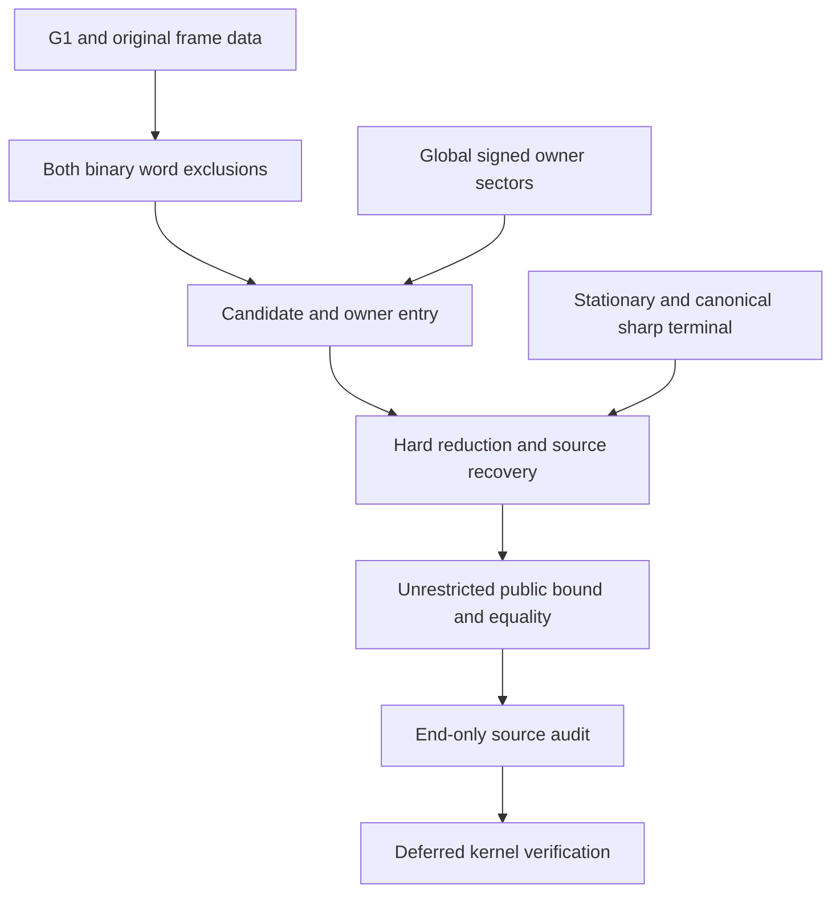

> **Current status is maintained in [the canonical handoff](TABLEFREE_HANDOFF_CURRENT.md).** The source-case and per-lane tables below are a 21-Oct/early-22-Oct historical implementation snapshot. In particular, negative-DE positive TD2 and small-EH TD2 scalar work advanced substantially after this table; see the canonical source matrix before selecting a task.

# Table-free formalization: live progress and remaining work

## Archived early-22-October source checkpoint

**Use [the consolidated live handoff](TABLEFREE_HANDOFF_CURRENT.md) for the latest status.** The [earlier source-only handoff](TABLEFREE_HANDOFF_2026_10_22_NONNEGATIVE_TOTALS.md) is archived; the 21-Oct implementation table below is historical. The prior session's seven `GlobalGAMixedNegativeA*`/`GlobalGANegativeA*` modules and handoff were verified in the actual PR branch. The broad BT2 nonnegative selected-A/E-total source dispatcher `GlobalGA.NonnegativeTotals.all_TD_false` handles TD0 and both TD2 signs (uncompiled). The negative-A normal-form and `cycle_reduce` are drafted (uncompiled), with two local fixes pushed in commits `c6ba426` and `f3fcdb9`. Next source work is the shorter/longer nonnegative-E comparisons for a single negative A primary and positive TD2, then the remaining E/BT owner matrix. None of this establishes a complete unrestricted owner classifier, unconditional `SharpSourceEntry`, or a new table-free public proof. Verification and optimization remain deferred.

**The milestones below were last globally reconciled on 21 October 2026; do not mistake their older per-lane descriptions for a later closure claim.**


Updated **21 October 2026, 18:08 UTC**. Branch: `formalize/eight-uncompiled-draft`.
Review: [PR #10](https://github.com/vltanh/lean4-squares-in-circles/pull/10).

**The unrestricted table-free formalization is not complete.** Substantial
continuous geometric components now have Lean source drafts, but the complete
word exclusions, global owner entry, original-source recovery, and public
theorem assembly are still open. The public theorem has not yet been replaced
by an unconditional table-free dependency chain.

This is a historical implementation ledger. The canonical handoff supersedes its per-lane status claims, historical owner counts and remaining-task priorities. The older
[ROADMAP.md](ROADMAP.md) remains the detailed target specification; the
[table-free hand-proof roadmap](TABLE_FREE_GEOMETRIC_HAND_ROADMAP.md) remains
the mathematical source map. Neither a completed hand proof nor a previously
reported pre-disconnection draft establishes that its current Lean source is
complete.

The complementary [G0–G9 closure ledger](TABLEFREE_LEAN_CLOSURE_ROADMAP_2026_10_21.md)
records the aggregate acceptance criteria, particularly the original-source
`SharpSourceEntry` gate. Its intervening published documentation commits are
preserved in this branch; the detailed checklist below records later source
checkpoints against those gates.

## Status vocabulary and workflow

- **Drafted:** a concrete Lean proof body and its stated local interface have
  been written and checkpointed. This does not mean elaborated or checked.
- **Active:** a named implementation lane is extending the proof now.
- **Pending:** a required proof or integration step has not been completed.
- **Recovery/integration:** retained components exist, but missing older source
  and the complete aggregate interface still need reconstruction.
- **Deferred:** outside the present source-drafting pass.

No Lean, lake, typechecking, tests, CI, native evaluation, or certificate
replay has been run in this continuation. No sampled bound is a proof premise. The final source
audit is deferred until all drafting is complete. All publication commits use
`[skip ci]`. Root owns commits and publication; the three implementation lanes
do not publish independently.

The actual common radius, literal source points, original weak separating
axes, closed ties, and rigid-anchor strict-loss provenance must survive every
reduction. A conclusion-shaped assumption is not a substitute for a missing
entry theorem. In particular, a transport descendant does not establish that
its owners were feasible at the original source, and motion of the free G/T
points is not rigid-anchor loss.

## 1. Current milestone ledger

Lean paths below are relative to `SquaresInCircles/Eight/TableFree/`.

| ID | Component | Current state | Concrete scope / remaining boundary |
| --- | --- | --- | --- |
| M1 | Geometric stationary existence | **Drafted** | `GeometricStationaryExistence.lean` constructs stationary data from compact geometric minima, continuity and interior stationarity. Radius strip and ceiling are consequences. Final identification with the public designated sharp datum remains part of assembly. |
| M2 | Four-state frame pair geometry (G1) | **Drafted** | `FrameAllPairs.all_pair`, `original_axis_pair`, and `continuous_pair_bound` cover all four radial branches, both pair orders, tangent signs and every original weak forward axis. Middle/high and high/high scalar and physical joins are included. |
| M3 | Frame concentration and original-radius transport | **Drafted and integrated** | `GlobalNormalization.lean` now obtains its actual-radius lift from `FramePhysicalTransport.quarter_lift`; the generated G1 pair call is removed. `NormalizationBridge.lean` retains literal original-radius squares, both variations and the initial selected physical normals. The generated word-classification step still remains. |
| M4 | Common quarter increments and no-double gate | **Drafted** | Common G2 increment arguments and `QuarterDoubleExclusion.no_double` are available. This does not exclude the two remaining binary wrong words. |
| M5 | Exact nearest-axis recoding and E ties | **Drafted** | `NearestAxisRecode.lean` preserves the square, center, radial kind and every signed-axis slack. `EDiagonalExclusion.lean` excludes E+ and E− at the original q using no-double. Other specified ties still depend on binary-word exclusions. |
| M6 | Second-word completed outer sectors | **Partly drafted: 6 of 10 representatives** | OppositeTwo, NegativeTwo, NegativeThree, PositiveThree, PositiveNegativeThree and OppositeThree have complete original-owner/reflection/physical/cycle drafts. Four zero-quarter outer families remain. Eight of twelve mixed-quarter representatives are now drafted, separately from this outer count. Neither binary aggregate is closed. |
| M7 | Full-variation high-GA secondary sector | **Drafted for its stated owners** | `GlobalGAPositiveTDExclusion.lean` completes the actual HG0/2, GA2, AB0, BT2, TD0/2, DE2, EH0 row, including all original TD error signs. The original owner hypotheses are still to be derived for the unrestricted sector. |
| M8 | Positive-TD2 high-GA sector | **Drafted** | Both coefficient families, all six polynomial reserves, their analytic radical/Taylor transfers, all sixteen concentration endpoints and the original-cycle contradiction are joined. No scalar positivity hypothesis remains in `actual_TD2_false` or `actual_secondary_either_TD_false`. |
| M9 | Hard sharp terminal and source recovery | **Universal hard theorem drafted; unrestricted entry pending** | `UniversalHardSharp.hard_sharp` covers arbitrary hard input at qLow≤q≤qStar. All large/small crossed HG/TD owners feed actual reductions and the same-radius common-frame clamp. `CrossedClampMotionCycle.common_clamp_data` derives its initial bounds and invariant budget from the actual source; strict A/B loss excludes the endpoint. The original middle strictness ledger recovers untouched-source alignment. This does not supply the still-missing unrestricted G3/G4 entry. |
| M10 | Critical/sole/paired positive E reduction | **Drafted for its stated entry** | The positive-GA BT2/TD0 exclusion now covers both E signs and its reflected positive-BT row. `PositiveGAOuterSoleReduction.lean` reduces all preprocessed T and E branches to an actual same-radius sole-primary outer-E endpoint. The remaining sole-E stress families are still open. |
| M11 | Unrestricted table-free public entry and equality | **Pending** | Existing public compatibility/capture dependencies have not been retired. All global entry hypotheses and original-source equality must be discharged before replacing that route. |
| M12 | Global original zero/quarter-owner signs | **Drafted; global normal-owner entry pending** | Every original low-quarter owner forces a positive outer target; every high-quarter owner forces a negative outer source, with all radial kinds and weak ties retained. Original anchor radial restrictions and the high-EH/low-GA exclusion are drafted. All-high quarter and three-zero charges are drafted; the full outer DE bridge and remaining global GA/BT exclusions are active. |

These are theorem-interface milestones, not an effort percentage. The open
global owner and contact arguments differ greatly in size.

## 2. Active lanes and immediate exit gates

| Priority / task | Owner | Next concrete deliverable | Depends on |
| --- | --- | --- | --- |
| P1 — Finish second-word mixed quarter pairs | `word_classification` | Complete role-3 C+→O+, C−→O+, O−→C+ and role-2 O−→C−, then the full mixed/core dispatcher. | All six nonzero outer representatives and eight mixed representatives now have actual original-owner/cycle drafts. |
| P2 — Restore wrong-word aggregates and zero families | root | Complete the short-word aggregate, four second-word zero-quarter outer families, mixed/core dispatch and literal-marker telescoping. | Retained short/mixed modules, the hand zero-quarter proofs and P1. |
| P3 — Complete original-owner entry | `owner_matrix` | Finish the all-high outer DE bridge and cycle contradiction, then the remaining GA/BT/EH owner restrictions. | Global signs/radial restrictions, high-EH/low-GA exclusion and all-high quarter/three-zero charges are drafted; no global owner classifier is yet available. |
| P4 — Complete the same-radius primary matrix | owner + source lanes | Join all positive, negative, canceling, reflected and sole-E primary rows with original rigid-anchor loss. | Completed sign-free BT2/TD0 row and all-T/all-E sole-primary reduction; remaining sole-E scalar families. |
| P5 — Recover arbitrary original hard source | `source_recovery` | Extend physical selected-normal and source-primary recovery to the universal hard theorem, then close the remaining sole-E matrix rows. | `UniversalHardSharp.hard_sharp` and the actual crossed clamp are now drafted, including the reflected branches without assuming a reflected E sign. |
| P6 — Candidate and normal-owner normalization | root + owner lane | Replace generated word classification and derive the remaining boundary-entry facts at the original radius. | P1/P2/P3 and the integrated G1 bridge. |
| P7 — Hard input to original sharp equality | root + source lane | Join all source-aware primary reductions, hard sharpness and the untouched-source physical witness recovery. | P4/P5/P6; the nonpositive-source recovery and rigid-anchor loss machinery are drafted. |
| P8 — Public theorem replacement | root | Unrestricted lower bound, attainment and full geometric equality family on the new dependency chain. | P7; stationary/public-datum link; existing geometric model adapters. |
| P9 — End-only source audit | root / independent review | Check exact APIs/import closure, missing recovered sources, all original-witness and strictness joins, and absence of generated capture on the new public route. Fix findings. | All source drafting complete. |
| P10 — Kernel and project verification | Deferred | Pinned Lean/mathlib elaboration, dependency/axiom/comparator checks and CI. | Separately authorized verification pass. No success is claimed now. |

## 3. Second wrong word: explicit remaining owner-family checklist

Every completed row must cover all four original weak axes, both permitted
angle halves, all closed coordinate endpoints, its reflected partner, and
the actual physical/cycle adapter. A scalar lemma alone does not close a row.

| Representative | Status | What remains |
| --- | --- | --- |
| Edge 2, (−,+): `OppositeTwo` | **Drafted** | Consume the completed cycle wrapper in the final dispatcher. |
| Edge 2, (−,−): `NegativeTwo` | **Drafted** | Consume the completed cycle wrapper in the final dispatcher. |
| Edge 3, (−,−): `NegativeThree` | **Drafted** | Consume the completed cycle wrapper in the final dispatcher. |
| Edge 3, (+,+): `PositiveThree` | **Drafted** | All original weak axes and both closed angle halves, reflection, physical and cycle wrappers are drafted. Consume the completed cycle wrapper in the final dispatcher. |
| Edge 3, (−,+): `OppositeThree` | **Drafted** | All original weak axes, both closed angle halves and the physical/reflected/cycle adapters are complete source drafts. Consume the cycle wrapper in the final dispatcher. |
| Edge 3, (+,−): `PositiveNegativeThree` | **Drafted** | The existing V/K global chords give cost > .8986 for every original weak axis on the whole quarter window. Reflection, physical and cycle wrappers are drafted; consume them in the final dispatcher. |
| Edge 0, (+,+) | **Recovery/integration** | Reconstruct same-sign zero-quarter family and original-owner join. |
| Edge 0, (+,−) | **Recovery/integration** | Reconstruct asymmetric opposite-sign zero-quarter family and original-owner join. |
| Edge 4, (+,+) | **Recovery/integration** | Reconstruct symmetric same-sign zero-quarter family and original-owner join. |
| Edge 4, (+,−) | **Recovery/integration** | Reconstruct symmetric opposite-sign zero-quarter family and original-owner join. |

Further second-word tasks:

- [ ] Reconcile retained core/core and mixed source modules with the actual
  current interfaces. Their complete recovered dispatcher is not established
  by the present construction ledger. Historical pre-disconnection completion
  reports must not be treated as current source completion.
- [ ] Complete the remaining mixed quarter contact families and their original
  weak-owner adapters, including any missing retained dependencies.
- [ ] Join all radial kinds, role/sign representatives and reflected edges.
- [ ] Sum the exact role-dependent inequalities, cancel the literal markers,
  and prove the physical second-word contradiction from the genuine lift.

For the first binary wrong word, component sources have been recovered in
parts, but `ShortWordExclusion.lean` was absent at the most recent direct
construction-interface read. Reconstruct its complete aggregate and any
missing dependencies; do not assume its pre-disconnection theorem survived.

## 4. Global high-GA and original-owner entry

The completed sector is specifically the original secondary A/E owner
sector. The positive-TD2 endpoint API is:

```text
baseline k l c z
endpoint k l c z (i j : Fin 4)
k ∈ [.5,.85], l ∈ [k,2k], c ∈ [k,2]
l ≤ 2 * tilted c z, tilted c z ≤ 2*l
tilted c z = c * (cos z + .293*sin z)
```

The baseline uses the exact clipped support `Secondary.clippedSupport 1 c`.
The original-state concentration conclusion is already derived from actual
containment and weak axes. The continuous weight families are drafted in
`GlobalGAPositiveTDWeights.lean`. `GlobalGATD2Coordinate.lean` gives the needed
low-angle coefficient monotonicity and uniform H cap, and
`GlobalGATD2LowEnvelope.low_scalars_positive` reduces all sixteen low-angle
endpoints to four specific scalar inequalities. Their exact polynomial
reserves are drafted in `GlobalGAPositiveTDLowPolynomial.lean`. The two upper
reserves, both analytic transfer modules and `GlobalGATD2UpperEnvelope.lean`
are now joined in `GlobalGAPositiveTDExclusion.lean`. The full original
secondary-sector contradiction has no remaining scalar premise.

`GlobalZeroSignBridge.lean` and `GlobalQuarterSignCycle.lean` additionally
classify every original zero/quarter weak owner at the source radius. The
normalization bridge now derives the HG2/TD0 sign implications and D's
negative tangent, rather than accepting them as entry hypotheses. The
remaining normal-owner and radial-anchor restrictions are still explicit.

Required global joins still open:

- [x] Positive-TD2 endpoint positivity and the complete secondary-sector
  contradiction, including every intrinsic endpoint alternative.
- [ ] All GA3/AB2 A-primary alternatives across signed primary totals.
- [ ] BT3 T-primary alternatives and their coupled total/error cases.
- [ ] DE3/EH1 E-primary alternatives, including paired and mixed signs.
- [ ] Negative-flat A, core-E and residual positive-BT3/negative-core-E
  transports from §§3–5 of `HAND_G3_GLOBAL_GA_OWNER_RIGIDITY.md`.
- [ ] Derive the selected owner domain, H/G/B/D signs, E normalization,
  A.y < 1/2 cut, original radial provenance and nonpositive zero-source outer
  classification from the actual candidate cycle.
- [ ] Join the complete global GA/EH/BT/D and anchor restrictions into the
  required boundary input. Existing small-error results or a finished
  conditional stress do not discharge this unrestricted front end.

The normal-entry theorem `PositiveGABT2TD0Exclusion.original_false`, now
including both E signs and its reflected row, is a separate completed
branch. It does not replace the global G3 high-GA theorem.

## 5. Word recoding, hard source recovery and final assembly

### Candidate geometry and ties

- [x] Complete G1 pair inequalities and original-radius frame/variation data.
- [x] Exact generic nearest-axis recoding with unchanged physical slack.
- [x] Exclude E+ and E− by common no-double, independently of binary words.
- [ ] Join the short-word exclusion to the G−/T+ tie obstructions.
- [ ] Join the second-word exclusion to the A+/B− tie obstructions.
- [ ] Combine the existing local zero-edge sign exclusions with these joins.
  H+/D− remain legitimate surviving-word recodings; do not exclude them.
- [ ] Prove actual dihedral candidate-word normalization at the original
  radius and connect it to the required candidate/boundary records.

### Canonical terminal and source recovery

- [x] Generated-free stationary existence, uniqueness linkage within its
  geometric datum, and stationary radius estimates.
- [x] Canonical nonpositive actual-cycle rigidity and five-anchor equality.
- [x] Complete hard sharpness for both nonpositive outer errors, all retained
  owners and arbitrary middle/E frames; scoped untouched-source recovery.
- [x] Complete ordered-normal hard sharpness for every HG/TD owner and
  outer-error sign, with strict original A/B circle losses.
- [x] The larger middle tangent forces its strict normal intermediate sign
  with either opposite sign, directly from the original circle/contact data.
- [x] Critical/sole/paired E reductions and the positive-GA BT2/TD0 E-tie
  contradiction, with radius eligibility derived from stationarity.
- [ ] Complete the exhaustive hard-input to canonical-endpoint reduction.
  Crossed outer/middle frame orders and small wrong intermediates remain.
- [ ] Carry original A/B data and strict H/D loss through middle alignment,
  outer/noncanceling/crossing sectors, and E endpoint/orientation reduction.
- [ ] Reconstruct any missing hard-source witness modules from the recovery
  record and prove original physical owner recovery, not merely descendant
  feasibility.
- [ ] Join source-aware G/T preprocessing, global primary entry, the hard
  terminal and original-source equality in one actual-radius theorem.
- [ ] Identify the geometric stationary witness with the public sharp datum
  and connect the original five-corner lower bound/equality adapters.

### Public exit gate

- [ ] The unrestricted lower bound accepts only the actual packing and
  containment data; no capture, owner, word, local-box or terminal result is
  supplied as an extra premise.
- [ ] Attainment and the full five-parameter geometric equality family,
  including reflected models and original-center necessity, use that route.
- [ ] Retire the compatibility/generated-capture dependency only after the
  replacement theorem is assembled.
- [ ] Run the deferred final source audit and resolve its concrete findings.
- [ ] Keep kernel/project verification explicitly separate from source-draft
  completion until it is authorized and actually performed.

## 6. Dependency order



## 7. Published checkpoints and update discipline

Recent remote checkpoints, all carrying `[skip ci]`:

| Remote commit | Preserved milestone |
| --- | --- |
| [46e047a](https://github.com/vltanh/lean4-squares-in-circles/commit/46e047af4961ab1522aaa75db24237e957eb30a0) | Complete original-axis G1 pair and cyclic marker interfaces. |
| [cd9648f](https://github.com/vltanh/lean4-squares-in-circles/commit/cd9648f6e3c1b2df938de2ac8cc8086f54a2b3c7) | Both whole-domain aligned opposite-three minima. |
| [ae1af54](https://github.com/vltanh/lean4-squares-in-circles/commit/ae1af549729c1951e634c954ce09ed4474ab97cd) | Original high-GA secondary sector and nonpositive-TD2 exclusion. |
| [4432617](https://github.com/vltanh/lean4-squares-in-circles/commit/4432617fc27252df95574167011c389f675f274b) | Original-radius concentration, physical transport, exact recoding and E-diagonal exclusion. |
| [6e90de0](https://github.com/vltanh/lean4-squares-in-circles/commit/6e90de05908d930a5b0ce4792060de1905bb4db9) | Actual positive-TD2 stress, D minorant and signed concentration. |
| [4311fc1](https://github.com/vltanh/lean4-squares-in-circles/commit/4311fc14a43eea0322ed05ae29b1df0d919ca78f) | Full early positive-three original owner and both diagonal boundary arcs. |
| [51094d7](https://github.com/vltanh/lean4-squares-in-circles/commit/51094d7d6fd5e76d739334d5613727c5da17dfcf) | Positive-GA BT2/TD0 diagonal branch closed; late positive-three contact bounds. |
| [099afce](https://github.com/vltanh/lean4-squares-in-circles/commit/099afced367f1d1271e9482fe23af9aab0ad6c2b) and [650d4dc](https://github.com/vltanh/lean4-squares-in-circles/commit/650d4dccfa8503b9982b59e9b753d7ee54b2954f) | G0–G9 closure ledger and status link; preserved when reconciling the remote head. |
| [29e5884](https://github.com/vltanh/lean4-squares-in-circles/commit/29e58841e1d79f4beca7ce105d0d869aac1250ed) | PositiveThree completed for all original weak owners, both closed angle halves, reflection and the physical cycle. |
| [4d60885](https://github.com/vltanh/lean4-squares-in-circles/commit/4d6088530750b38d034e7c63a7b030a3a0929bc4) | Explicit positive-TD2 weight families, exact scalar algebra and genuine coordinate bounds. |
| [4f5f2e3](https://github.com/vltanh/lean4-squares-in-circles/commit/4f5f2e3dae8123c241910e15787002819c43724a) | PositiveNegativeThree completed on the whole quarter window with cost > .8986 and actual-cycle wrappers. |
| [332e321](https://github.com/vltanh/lean4-squares-in-circles/commit/332e3216f979593ee901d967042b048b6734e4d1) | Low-angle four-to-sixteen endpoint envelope and all four exact low polynomial reserves. |

At each substantive checkpoint, update the affected milestone and checklist,
record the exact exported interface and its remaining premises, and add the
remote commit link. Move a task to **Drafted** only after the complete scoped
proof body is saved. Do not promote it to checked or claim that generated
dependencies disappeared without the corresponding completed verification.

The publication checkpoint is the preservation mechanism for the ongoing
proof work.

## 8. Continuation checkpoints through 16:13 UTC

Every item below is an **uncompiled source draft**. Only the stated scope is
closed; the complete unrestricted table-free theorem remains open. G2–G6
remain partial throughout these checkpoints.

| UTC time on 2026-10-21 | Remote commit | Gate | Exact scope and remaining boundary |
| --- | --- | --- | --- |
| 15:36:01 | [c31973b](https://github.com/vltanh/lean4-squares-in-circles/commit/c31973b5b99f69ee1e85b9e27a94dbb541648998) | G1 | Actual-radius quarter lift integrated into normalization; generated word classification remains. |
| 15:36:12 | [20c2f2f](https://github.com/vltanh/lean4-squares-in-circles/commit/20c2f2f669ebe44e20152f7408060a1b705e8f3c) | G4 | Positive-GA BT2/TD0 row for both E signs and its reflected row. |
| 15:37:28 | [1b4e7b7](https://github.com/vltanh/lean4-squares-in-circles/commit/1b4e7b7385576ca3716d8af527161e8f8bae7f3c) | G5 | Nonpositive hard terminal with original rigid anchors, for its stated endpoint. |
| 15:37:32 | [6b4b395](https://github.com/vltanh/lean4-squares-in-circles/commit/6b4b39577398433393e9806d328d8e3ff6b8a4c2) | G6 | Initial source axes, points and physical normals recovered for the completed class. |
| 15:37:35 | [95a01e7](https://github.com/vltanh/lean4-squares-in-circles/commit/95a01e791555e6464e61f6fe7f308eba9e5a4963) | G4 | All preprocessed positive-GA T/E branches reach an actual sole-primary outer-E endpoint; remaining scalar families open. |
| 15:37:39 | [41e2480](https://github.com/vltanh/lean4-squares-in-circles/commit/41e2480fd4ccb5024a136c4592563ab227443024) | G2 | Both original opposite-three upper secondary owners on the full continuous domain. |
| 15:42:35 | [79d63ee](https://github.com/vltanh/lean4-squares-in-circles/commit/79d63ee496854fac1c634f8081d9321d1f7ee456) | G1/G3/G6 | Original-radius normalization retains actual squares, signed variations and initial normals. |
| 15:42:39 | [721591c](https://github.com/vltanh/lean4-squares-in-circles/commit/721591cd3c80f09c94381c8a0528dee7f1e1b2be) | G3 | Upper TD2 endpoint envelope and exact polynomial reserves. |
| 15:42:42 | [1c89e3e](https://github.com/vltanh/lean4-squares-in-circles/commit/1c89e3e235f79969afb7e4a003f6f1713c50de1a) | G5/G6 | Complete nonpositive-outer hard class with arbitrary middle/E frames and all zero owners; scoped source recovery. |
| 15:42:45 | [c941605](https://github.com/vltanh/lean4-squares-in-circles/commit/c94160540c172f889d00e8e7e96189579890afa2) | G2 | Every lower opposite-three primary owner implies an original secondary contact, with weak ties. |
| 15:47:07 | [e625acb](https://github.com/vltanh/lean4-squares-in-circles/commit/e625acb15eb70a943504361d3cdeaa8a6ee7b49f) | G3 | All four low-angle TD2 analytic scalars and low endpoint positivity without scalar premises. |
| 15:47:10 | [3da35c0](https://github.com/vltanh/lean4-squares-in-circles/commit/3da35c08adbe989e43d42dd6095ae3e7c1876b0c) | G2 | Primary contact motion, complete lower source-primary owner and small upper source-primary region. |
| 15:47:12 | [c705a20](https://github.com/vltanh/lean4-squares-in-circles/commit/c705a20b6ba61fba177540c8d1ef8149ad79d56a) | G5 | G−/T− and stated one-negative contradictions through strict original H/D loss. |
| 15:48:24 | [5370328](https://github.com/vltanh/lean4-squares-in-circles/commit/53703286db0269dacc50726d0c7e89ae89a6fa97) | G3 | Actual TD2 row and secondary TD0/2 row complete, both scalar ranges and all sixteen endpoints. |
| 16:02:51 | [c0fc15a](https://github.com/vltanh/lean4-squares-in-circles/commit/c0fc15a62171bf32085407be49c8664ca8759384) | G2 | Complete upper source-primary owner at actual weak contacts. |
| 16:02:54 | [3e3aac8](https://github.com/vltanh/lean4-squares-in-circles/commit/3e3aac8fe94d76b1653f0375621c54b99e841b4a) | G5 | Whole small-middle scalar and actual zero-G endpoint contradiction at the original budget. |
| 16:02:57 | [88c1ef4](https://github.com/vltanh/lean4-squares-in-circles/commit/88c1ef474dd053e737b94dfe40252b48ce17aeb3) | G3 | Global zero-owner sign support, every chart/radial kind and weak tie. |
| 16:03:00 | [5a8c593](https://github.com/vltanh/lean4-squares-in-circles/commit/5a8c593b38584027f3fda8e793296dc8776ae4d6) | G5 | Continuous circle and clipped-angle majorants for the signed opposite envelope. |
| 16:03:04 | [dcee7f9](https://github.com/vltanh/lean4-squares-in-circles/commit/dcee7f900ccbc82d1cbd275dec1ee37ddd75fbd6) | G3 | Original-q zero-owner classifier; normalization derives HG2/TD0 signs. |
| 16:03:08 | [360b040](https://github.com/vltanh/lean4-squares-in-circles/commit/360b0403f49c18fdc72e98b0a18abff8ed4ec404) | G2 | Complete opposite-three upper target diagonal and original late-source motion. |
| 16:03:11 | [a22c169](https://github.com/vltanh/lean4-squares-in-circles/commit/a22c169ed414e229fee05e219d452343a5bf4559) | G2 | All four original upper opposite-three owners complete; two lower-secondary minima remain. |
| 16:03:14 | [eafb1af](https://github.com/vltanh/lean4-squares-in-circles/commit/eafb1af57b4873d1ab7d9f94b61185a50ae0799e) | G5 | Actual small-positive HG0 alignment with strict original A loss, without temporary lift. |
| 16:13:25 | [45cb195](https://github.com/vltanh/lean4-squares-in-circles/commit/45cb195eeceb0b1569f8c5c91c6a872df3b7826d) | G5 | Exact local-budget reflection and small-positive TD2 alignment with strict original B loss; original E retained. |
| 16:13:29 | [4a0f7c7](https://github.com/vltanh/lean4-squares-in-circles/commit/4a0f7c79ba028c9d3e8525071e2b5dc4b9fd7d1e) | G5 | Complete signed opposite scalar and both larger-middle source signs, without opposite-sign/envelope premises. |
| 16:13:33 | [c84b614](https://github.com/vltanh/lean4-squares-in-circles/commit/c84b614c41dc2c0e67c310e95fbd4cb7e8db25ea) | G3 | Every original quarter-owner sign and D<0/DE restriction; normalization derives D's sign. |
| 16:13:36 | [77e1215](https://github.com/vltanh/lean4-squares-in-circles/commit/77e1215f5482ca6bcf10ec79da2f9a5b610e0053) | G5 | Complete ordered-normal hard sharpness, all outer owners/errors and original anchor losses; crossed/wrong-small remain. |
| 16:13:39 | [c8247b6](https://github.com/vltanh/lean4-squares-in-circles/commit/c8247b6f7f9ce48c724d2d6469ba0b203f34cea7) | G2 | Actual lower contact-domain reductions and derivative identities; the lower minimum inequalities remain open. |

