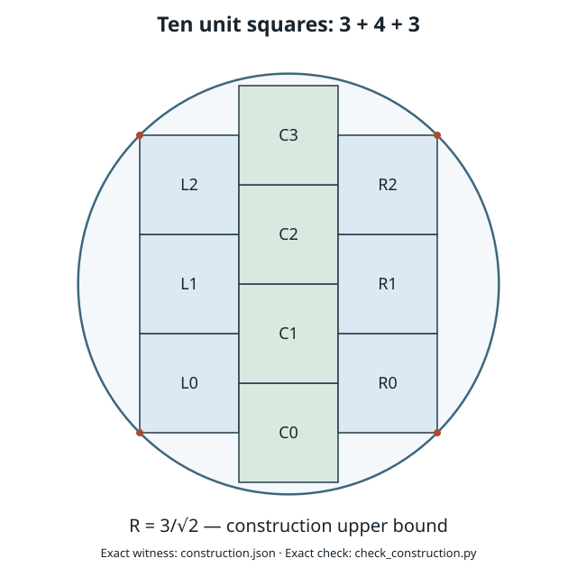

# Ten unit squares in a circle

Research checkpoint: 2026-10-25 (UTC), based on main commit
`4bea747b3efa13c869b956cb28435efaf21526fa`.

Resume from [HANDOFF.md](HANDOFF.md) for the current proof gaps, next steps,
failed shortcuts, and validation record.

**The sharp radius and complete equality family are proved by hand for the
entire common-coordinate-separated class, including independently rotated
squares, and for unrestricted packings with eight square centers at distance
at least `1` from the disk center. The remaining unrestricted cases are OPEN.**
The radius is `R* = 3/√2`, with squared radius `Q = 9/2`. Common-coordinate
separation means that one fixed pair of perpendicular directions separates
every square pair by disjoint projection interiors along at least one of
the directions. This is an additional hypothesis on `Packing`.

This research does not extend the public n≤8 Lean theorems.

Erich Friedman's [Squares in Circles](https://erich-friedman.github.io/packing/squincir/)
page, consulted on 2026-10-23, lists this n=10 radius and credits the construction
to Friedman (1997). It lists only n=1–8 as proved optimal. The coordinates and
arguments below are derived and checked here; the reference is provenance for
the known bound, not a lower-bound proof.

## What is established here

| Result | Evidence | Scope |
| --- | --- | --- |
| Ten squares fit at `Q = 9/2` | [Exact hand proof](CONSTRUCTION.md), [rational witness](construction.json), [checker](check_construction.py) | Upper bound only |
| Sharp radius and complete six-parameter equality family for all parallel packings | [All-parallel theorem](ALL_PARALLEL_THEOREM.md) | Arbitrary centres; common square orientation |
| Same sharp theorem with independent orientations and common-coordinate separation | [Rectification theorem](COORDINATE_RECTIFICATION.md) | One common orthogonal separating frame |
| Complete physical completion of four anchors | [Anchored equality classification](ANCHORED_EQUALITY_CLASSIFICATION.md) | Remaining six orientations initially unrestricted |
| Three squares in a sharp cap force alignment and boundary anchors | [Three-square cap](THREE_SQUARE_CAP.md) | Arbitrary orientations, all wholly beyond a line at distance `1/2` from the disk centre |
| A square in an outward quadrant forces the sharp corner bound | [Corner rigidity](CORNER_RIGIDITY.md) | Arbitrary orientation |
| At least two squares enter the central disk of radius `1/2` | [Exterior-arc bound](CENTRAL_DISK_REDUCTION.md) | Arbitrary orientations; squared containing radius at most `9/2` |
| Eight exterior squares force four anchors; the exactly-two-central case is closed | [Sharp exterior ring](SHARP_EXTERIOR_RING.md) | Arbitrary orientations; no common separating frame assumed |
| Eight centers outside the open unit disk force four anchors | [Center-radius reduction](CENTER_RADIUS_REDUCTION.md) | Arbitrary orientations; a smaller ten-packing must have exactly 3, 4, or 5 centers in the open unit disk |
| A square's arc cost bounds its center's squared radius | [Inner arc moment](INNER_ARC_MOMENT.md) | Hand proof; the proposed five-center moment bound remains open |
| An inner center of norm at least `.9` costs more than `pi/6` on the test circle | [Large inner arc](LARGE_INNER_ARC.md) | Hand proof; at most two such centers in the four-inner case and at most one in the three-inner case |
| Five inner centers either form the aligned plus or a strict convex pentagon | [Moment reductions](FIVE_CENTER_MOMENT_REDUCTIONS.md) | Hand proof; independent outward radial translations preserve disjointness |
| The five-center moment exceeds four when every separating-normal turn is at most `pi/2` | [Small-turn moment theorem](FIVE_CENTER_SMALL_TURNS.md) | Conditional hand proof using three explicit rational certificates; larger turns remain open |
| Four inner squares have hull width at least two in every direction | [Four-center width](FOUR_CENTER_WIDTH.md) | Hand proof; does not yet exclude six outer squares |
| Three squares wholly inside the test circle almost fill a smaller circle | [Three-core stability](THREE_CORE_INNER_STABILITY.md) | Hand proof with an explicit no-protrusion hypothesis |
| Two or three origin-vertex squares bound total capacity by nine or eight | [Origin-vertex capacity](THREE_ORIGIN_VERTEX_SQUARES.md) | Hand proof for squared containing radius at most `17/4` |
| One origin-vertex square plus three radial side terminals bounds capacity by nine | [One-origin capacity](ONE_ORIGIN_VERTEX_THREE_TERMINALS.md) | Hand proof at squared radius `17/4` |
| Two fixed interior points stab every square in the specified upper one-unit neck | [One-neck stabbing theorem](ONE_NECK_STABBING.md) | Complete hand proof at `17/4`; implies capacity two in that region |
| An aligned two-by-two block translated along a side direction admits at most five further squares | [Translated-block obstruction](TRANSLATED_BLOCK_OBSTRUCTION.md) | Hand proof with the four core centers in the closed unit disk; remaining orientations arbitrary |
| A solid two-by-two block with two center norms above `.9` admits at most five outer-center squares | [Localized-block obstruction](LOCALIZED_BLOCK_OBSTRUCTION.md) | Conditional hand proof allowing arbitrary translation; its application uses computational radial localization |
| Five centers in the closed unit disk are impossible for a ten-packing | [Radial weight certificate](RADIAL_WEIGHT_EXCLUSION.md), [integer checker](check_radial_weight_exclusion.py) | **Computer-assisted** reduction; not a hand proof |
| Four inner centers must split into two norms at most `.65` and two above `.9` | [Radial count localization](RADIAL_COUNT_LOCALIZATION.md), [integer checker](check_radial_count_localization.py) | **Computer-assisted**, conditional on exactly four inner centers |
| Sharp lower bound from four anchors | [Four-anchor bound](FOUR_ANCHOR_BOUND.md) | Four common-frame squares with the stated coordinate gaps |
| Exact finite formulation and existence of a minimizer | [Unrestricted model](UNRESTRICTED_MODEL.md) | Arbitrary individual orientations; no sharp lower bound |

The earlier [three-column theorem](THREE_COLUMN_THEOREM.md) is retained as a
short special case; the all-parallel theorem removes its column hypothesis.
The [six-parameter family](CONSTRUCTION.md#six-parameter-family) is now proved
exhaustive within the common-coordinate class and within the four-anchor
class. Global exhaustiveness is not proved.

The hand arguments have received separate mathematical review within this
work session. The rational checker certifies the displayed witness; it is
not a premise of the lower-bound proofs. **No n=10 Lean source has been
compiled or kernel-checked.**



## Roadmap and next obligation

| Gate | Status | Required result |
| --- | --- | --- |
| G0: source and model | Hand argument complete | Use unrestricted `Packing`; preserve boundary contact |
| G1: attaining construction | Hand proof and exact arithmetic check complete | `∃ S : Fin 10 → UnitSquare, Packing S (0,0) (3/√2)` |
| G2: common-coordinate theorem | CLOSED by hand, including equality | All-parallel chain argument, then disk-preserving rectification |
| G3: unrestricted lower bound | OPEN; eight-outer-center case closed | Exclude packings below `9/2` with exactly 3, 4, or 5 centers in `B(0,1)` |
| G4: unrestricted equality necessity | OPEN; eight-outer-center case closed | Exclude or classify equality structures with at least three centers in `B(0,1)` |
| G5: Lean formalization | OPEN | Elaborate proofs, audit axioms, and verify statements against `Packing` |
| G6: public integration | OPEN | Extend the registry and public theorem range only after verification |

The next mathematical task is a lower-bound argument covering configurations
outside the common-coordinate class. The rectification proof preserves
separation because it shrinks each square's bounding box. For a merely
physical packing those bounding boxes can overlap, so that argument does
not supply a global reduction.

The cap and corner theorems give precise unrestricted necessary conditions:
in a hypothetical packing with `q<9/2`, every central open strip of width one
meets at least six squares, and every square meets the union of the two such
perpendicular strips. These conditions have not been shown contradictory.
Finding a sharp cap triple in some frame would close the lower bound, but
no universal cap-extraction theorem is claimed.

The sharp exterior-ring theorem uses the circle of radius
`sqrt(1+1/sqrt(2))`: every square avoiding `B(0,1/2)` occupies an arc of angle
at least `pi/4`. Eight such squares must alternate two equality types and
therefore supply the four anchors. This proves that every hypothetical
ten-square packing below `9/2` has **at least three central squares**. It also
closes the complete equality classification when exactly two are central.

The center-radius strengthening proves the same minimum arc angle whenever
the square's center has norm at least `1`, even if the square intersects
`B(0,1/2)`. Its third possible equality type cannot occur in an eight-arc
ring. Consequently any smaller ten-packing must have at least three centers
in `B(0,1)`; pairwise center distances of at least one bound this count by
five. The precise remaining counts for the hand proof are therefore **3, 4,
and 5 inner centers**.

The separate radial-weight certificate excludes five inner centers by 1,954
exact integer parameter-box comparisons. With that computational result the
remaining counts are three and four. An analytic replacement is still needed
for a wholly hand proof: the inner-arc moment theorem would provide one if
the explicitly stated five-center moment inequality is proved. Neither the
certificate nor the conditional moment argument closes the other two cases.

The [large-inner-arc lemma](LARGE_INNER_ARC.md) replaces one branch of the
radial-count argument by hand. A proposed unrestricted bound of five usable
outer arcs around four inner squares is false: the exact
[gap obstruction](FOUR_CORE_GAP_OBSTRUCTION.md) allows six abstract arcs.
The [localized gap counterexample](LOCALIZED_FOUR_CORE_GAP_OBSTRUCTION.md)
also defeats that bound under the two-small/two-large radial split.
The [translated-block theorem](TRANSLATED_BLOCK_OBSTRUCTION.md) and
[localized solid-block theorem](LOCALIZED_BLOCK_OBSTRUCTION.md) nevertheless
exclude their stated physical core classes. The simpler center-only argument
has its own [exact limitation](DIAGONAL_BLOCK_CENTER_RELAXATION.md).

A [rational six-square example](SIX_CENTRAL_SQUARES.md) rules out the shortcut
that at most four or five squares can meet the small disk. It is not a
ten-square packing. The remaining argument must use the interaction between
central and exterior squares; a small central count alone is insufficient.

Two further manuscripts record a separate approach through contact forces.
[Physical tree reductions](PHYSICAL_TREE_REDUCTIONS.md) proves a cover of
all positive bridges by at most four circle-clear squares, classifies tree
components with exactly two loaded squares, and excludes stars above an
explicit radius. Its stress-existence inputs are pinned to the cited n=9
research commit. These are conditional graph results, not an exhaustive
classification of a minimizing packing.

[Staggered-chain completion](STAGGERED_CHAIN_REDUCTION.md) proves that six
additional squares around a specified four-square chain must split above
and below it. A precise arbitrary-orientation upper-triple lemma would finish
that case; the lemma is still open. The note proves its axis-parallel version
and its common-maximal-chord version, and gives an exact obstruction to every
universal two-point stabbing shortcut. The [origin-vertex capacity theorem](THREE_ORIGIN_VERTEX_SQUARES.md)
closes two specified tree families at squared radius `17/4`; it does not
establish that a general minimizing packing has one of those families.

Even the established equality family can have five distinct x-coordinates;
the all-parallel proof handles those configurations directly. No unproved
three-column normalization is used.

For the eventual Lean construction, the existing
[`Common/Constructions.lean`](../../SquaresInCircles/Common/Constructions.lean)
provides `axis_packing`. The new witness can be defined in a separate n=10 module
without changing `optimalRadius`, whose value at 10 is currently a placeholder.
The unrestricted formulation uses the interfaces of
[`Geometry.lean`](../../SquaresInCircles/Geometry.lean) and
[`Common/SeparatingAxes.lean`](../../SquaresInCircles/Common/SeparatingAxes.lean).

## Reproduce the checks

From the repository root, with Python 3 and no external packages:

```sh
python3 research/ten/check_construction.py --self-test
python3 research/ten/check_core_obstruction.py
python3 research/ten/check_radial_weight_exclusion.py
python3 research/ten/check_radial_count_localization.py
python3 -B research/ten/plot_construction.py
```

The first command checks all 40 vertices and 45 pairs using `Fraction`, identifies
the four tight corners, and rejects deliberately overlapping, exterior, and
floating-point witnesses. Vertex containment implies whole-square containment
by convexity of the disk. The central-obstruction checker verifies six squares,
all 15 separating pairs, and strict near/far distance bounds using rational
arithmetic. The radial-weight checker proves continuous one-square bounds
using integer Riemann sums and a complete dyadic parameter cover; it uses no
floating-point arithmetic. The figure uses floating point only for drawing
and is not a proof input.

This checkpoint changes only `research/ten/`. No Lean build, axiom audit,
Comparator run, or external kernel replay is claimed. Commits use `[skip ci]`
for this research-only draft, following the existing research PR convention.
